# PlannedAgent: Stage 1 Design Report

**EECS 3311 Software Design, Fall 2026. Course Project, Stage 1 (Software and Agent Design)**
**Author:** Milad Jafarieh

> Every part of this report has an ID so it can be traced: features F01 to F11, use cases UC01 to UC13, sequence diagrams SD1 to SD9, class diagram views CD0 to CD6 and design patterns P1 to P7. The UML diagrams were drawn in UMLet; the source files are in [`diagrams/uxf/`](diagrams/uxf/) and the images in [`diagrams/png/`](diagrams/png/). Section 8 links everything together in one table.

## Contents

1. [Project overview](#1-project-overview)
2. [Feature specifications](#2-feature-specifications)
3. [UML class diagram](#3-uml-class-diagram)
4. [Design patterns](#4-design-patterns)
5. [Use-case diagram](#5-use-case-diagram)
6. [Use-case descriptions](#6-use-case-descriptions)
7. [Sequence diagrams](#7-sequence-diagrams)
8. [Feature-to-design traceability table](#8-feature-to-design-traceability-table)
9. [How each feature is realized](#9-how-each-feature-is-realized)
10. [Important design decisions](#10-important-design-decisions)
11. [Stage 1 requirement checklist](#11-stage-1-requirement-checklist)

---

## 1. Project overview

### 1.1 Problem and motivation

Students have classes, labs, assignments, a part-time job, workouts and errands. The tasks live in a to-do list and the time lives in a calendar, so every week the student has to decide by hand when each task will happen. That plan also breaks as soon as something changes: a missed task, a class that runs late, a rainy day.

To-do apps store tasks but do not place them in time. Calendars show events but do not plan tasks. A chatbot can talk about a plan, but it cannot see the calendar, it cannot promise a plan without double-booking, and it can make things up.

### 1.2 Target users

University students (for example at York) who mix a fixed timetable with deadlines, work and personal goals. The app also suits anyone who wants a weekly plan built from quick notes.

### 1.3 What the agent does

PlannedAgent is a desktop app with a GUI and a command line. Its AI agent:

* turns a quick sentence into tasks ("EECS report Friday, about 3 hours, gym 3 times, groceries");
* plans the week in steps: it reads the tasks and the schedule with tools, places the tasks in free time, checks for problems and explains the result;
* changes the plan when asked in plain language ("move gym to Wednesday at 7am"), and every change can be undone;
* remembers the student's rules ("no studying after 10pm") and the scheduler obeys them;
* avoids rain for outdoor tasks, reschedules missed tasks at the end of the day and writes a short weekly report.

The agent only proposes changes. The student sees each proposal and decides whether to apply it.

### 1.4 Why an AI agent is a good fit

The problem has two sides. Understanding loose language ("sometime this week", "after class", "I was too tired tonight") and deciding what to look up next is what an LLM is good at. Exact work, such as finding free time, respecting deadlines and never placing two things at once, is what normal code is good at.

An agent joins the two: the LLM decides the next step and calls a tool, and the tools are plain Java that do the exact work. One single question to an LLM would not be enough, because the agent must read data, act, look at the result and sometimes ask the student a question.

### 1.5 AI / LLM models

| Use | Model | Why |
|---|---|---|
| Default (cloud) | Google Gemini API, free tier, model `gemini-3.5-flash-lite` (a setting) | Free, fast, can answer in JSON |
| Local option | Qwen running on the author's laptop through Ollama (for example `qwen3:8b`) | Free, private, works offline, no daily limit |

The model is chosen with one setting (`PLANNER_LLM=gemini` or `PLANNER_LLM=ollama`). The rest of the program does not change, because both are hidden behind the same `LlmClient` interface (Adapter pattern, P5).

### 1.6 How the AI connects to the rest of the system

* Every AI call goes through the `LlmClient` interface, which has one method: `complete(request)`. `GeminiClient` and `OllamaClient` translate that call to each provider's own web API.
* In chat, the `Agent` runs a short loop of at most 6 steps:
  1. `buildRequest()` puts together the rules, the list of tools, the student's preferences and the recent conversation.
  2. The LLM answers with one JSON step: either a tool to call with its arguments, or a final answer.
  3. `parseStep()` reads that step.
  4. The `Agent` runs the tool and adds the result to `ConversationMemory`.
  5. The loop repeats until there is a final answer.
* Two features use a single LLM call instead of the loop: adding tasks from text (`TaskExtractor`) and the weekly report (`ReportService`).
* The LLM does not change data itself. Tools that change the plan return a `Proposal`, which is a list of command objects. The commands run only when the student clicks Apply, and they can be undone (Command pattern, P3).

### 1.7 Overall architecture

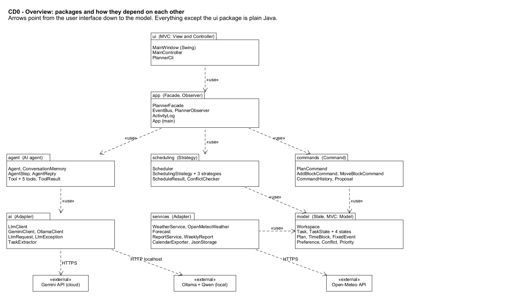
*Figure 1. Packages and their dependencies (CD0).*

The program is built in layers:

| Layer | Packages | What it does |
|---|---|---|
| User interface | `ui` | Swing window (`MainWindow`, `MainController`) and the command line (`PlannerCli`) |
| Application | `app` | `PlannerFacade`, the one entry point, plus notifications (`EventBus`) |
| Logic | `agent`, `scheduling`, `commands` | The AI agent and its tools, the scheduler and its strategies, plan changes with undo |
| Outside world | `ai`, `services` | LLM providers, weather, report, calendar export, file storage |
| Data | `model` | `Workspace`, tasks with their states, events, blocks and preferences |

Arrows only point downwards. Only the `ui` package uses Swing; everything else is plain Java, so the same logic could later be reused in another app with a different screen.

### 1.8 How the user interacts: GUI and CLI

**GUI (Swing).** One window with three panels:

* Tasks panel: the task list, a text box for adding tasks from a sentence, and buttons to add, edit, complete and delete tasks.
* Week panel: the week with fixed events and planned blocks, and buttons for Auto-schedule (with a strategy list), Check conflicts, Review today, Weekly report, Undo, Redo, Add event and Export .ics.
* Chat panel: the conversation with the agent, a status line ("using schedule_tasks"), and a proposal card with Apply and Discard.

**CLI.** The same features from a terminal:

| Feature | GUI | CLI |
|---|---|---|
| F01 Add tasks from text | Tasks panel, Add from text | `plannedagent add "<text>"` |
| F02 Manage tasks | Tasks panel buttons | `plannedagent tasks`, `plannedagent done <id>` |
| F03 Fixed events, export | Week panel, Add event, Export .ics | `plannedagent event add ...`, `plannedagent export week.ics` |
| F04 Auto-schedule | Week panel, Auto-schedule | `plannedagent schedule --strategy deadline` |
| F05 Plan with the agent | Chat panel | `plannedagent ask "<message>"` |
| F06 Check conflicts | Week panel, Check conflicts | `plannedagent conflicts` |
| F07 Change by chat, undo | Chat panel, Undo, Redo | `plannedagent ask "..."`, `plannedagent undo`, `plannedagent redo` |
| F08 Weather | Outdoor box on a task, rain warnings | warnings printed by `schedule` and `conflicts` |
| F09 Preferences | Chat panel | `plannedagent ask "I never study after 10pm"` |
| F10 Review the day | Week panel, Review today | `plannedagent review` |
| F11 Weekly report | Week panel, Weekly report | `plannedagent report` |

### 1.9 Technology

Java 21, Swing for the GUI, JUnit 5 for tests, Gson for JSON, Maven as the build tool (it opens directly in Eclipse), Java's built-in `HttpClient` for web calls, the Gemini API or Ollama for the LLM, and the Open-Meteo API for the weather.

### 1.10 Scope

Included: one student on one computer, the 11 features in Section 2, English input. Not included: sharing with other users, live syncing with Google Calendar, a phone app, and splitting a long task over several blocks.

---

## 2. Feature specifications

PlannedAgent has 11 features. Simple actions such as opening the app or changing settings are not counted.

| ID | Feature | Type | Use case | Sequence diagram |
|---|---|---|---|---|
| F01 | Add tasks from plain text | Hybrid | UC01 | SD2 |
| F02 | Manage tasks and their status | Deterministic | UC02 | SD2, SD5, SD8 |
| F03 | Fixed events and calendar export | Deterministic | UC03 | SD9 |
| F04 | Auto-schedule with a chosen strategy | Deterministic | UC04, UC12 | SD3, SD5 |
| F05 | Plan the week with the agent | AI agent (hybrid) | UC05, UC12 | SD4, SD5 |
| F06 | Check conflicts | Deterministic | UC06 | SD6 |
| F07 | Change the plan by chat, with undo and redo | Hybrid | UC07, UC12, UC13 | SD6, SD5 |
| F08 | Weather-aware scheduling | Hybrid (external API) | UC08 | SD3 |
| F09 | Remember preferences | Hybrid | UC09 | SD7 |
| F10 | End-of-day review | Hybrid | UC10, UC12 | SD8, SD5 |
| F11 | Weekly report | Hybrid | UC11 | SD9 |

### F01: Add tasks from plain text

* **Description.** The student types several tasks in one sentence. The LLM turns the sentence into a list of tasks, each with a title, a length in minutes, a deadline, a priority and an outdoor flag. The student checks the list before anything is saved.
* **User interaction (GUI).** In the Tasks panel the student types into the text box and clicks Add from text. The tasks appear in a list that can be edited. Save adds them.
* **Input.** The sentence and today's date.
* **Output.** New `Task` objects in the To-do state, saved in the workspace.
* **AI involvement.** Hybrid. The LLM reads the text; plain Java checks the result (title present, length from 5 to 600 minutes, deadline not in the past) and creates the tasks.
* **Expected workflow.** `MainController.onAddText()` -> `PlannerFacade.tasksFromText()` -> `TaskExtractor.extract()` -> `LlmClient.complete()` -> `TaskExtractor.readTasks()` -> the list is shown -> `onSaveTasks()` -> `saveTasks()` -> `Workspace.addTask()` for each task -> `JsonStorage.save()` -> observers are notified (SD2).
* **Errors and alternatives.** Empty text is rejected before any LLM call. If the LLM is not available or the daily limit is used up, the student sees "AI is not available, add the tasks by hand" and can use the normal task form (F02). If the reply is not valid JSON, nothing is saved and the student is told. A task with a problem is highlighted so the student can fix it.

### F02: Manage tasks and their status

* **Description.** The student can add, edit, delete and complete tasks by hand. Every task has a status: To-do, Scheduled, Done or Missed. What a task can do depends on its status; for example a Done task cannot be scheduled. The State pattern (P2) handles these rules.
* **User interaction (GUI).** The Tasks panel shows every task with its status, and has New, Edit, Delete and Mark done buttons.
* **Input.** Task fields (title, minutes, deadline, priority, outdoor) or a task id.
* **Output.** The updated task list, or a message if a change is not allowed.
* **AI involvement.** Deterministic.
* **Expected workflow.** New, Edit and Delete call `onAddTask()`, `onEditTask()` and `onDeleteTask()`, which call `PlannerFacade.addTask()`, `updateTask()` and `deleteTask()` (`Workspace.removeTask()`). Mark done: `MainController.onComplete()` -> `PlannerFacade.completeTask()` -> `Workspace.getTask()` -> `Task.complete()` -> the current `TaskState` decides -> `Task.setState(new DoneState())` -> save and notify.
* **Errors and alternatives.** Completing a task that is already done raises an `IllegalStateException` and the student sees "This task is already done". An empty title or a length of 0 is rejected. An unknown id gives a message.

### F03: Fixed events and calendar export

* **Description.** The student enters fixed commitments such as lectures, labs and work shifts. The scheduler does not place tasks on top of them. The planned week (events and task blocks) can be exported to an `.ics` file, which Google Calendar, Outlook and Apple Calendar can open.
* **User interaction (GUI).** In the Week panel, Add event asks for a title, a day, a start and an end. Export .ics asks for a file name.
* **Input.** Event title, start and end; a file name.
* **Output.** A `FixedEvent` in the workspace; an `.ics` file.
* **AI involvement.** Deterministic.
* **Expected workflow.** `onAddEvent()` -> `PlannerFacade.addEvent()` -> `Workspace.addEvent()` -> save. `onExport()` -> `PlannerFacade.exportCalendar()` -> `CalendarExporter.export()` (SD9).
* **Errors and alternatives.** An end time before the start time is rejected. An event that overlaps another is allowed, but the conflict check reports it. If the file cannot be written, the student sees an error.

### F04: Auto-schedule with a chosen strategy

* **Description.** One click places every task that needs a time slot into free time. The student picks the strategy: deadline first, priority first or shortest first. This feature does not use the LLM, so it also works offline. The result is a proposal that the student applies or discards.
* **User interaction (GUI).** In the Week panel the student picks a strategy and clicks Auto-schedule. The proposal shows the new blocks, any conflicts and the tasks that did not fit, with Apply and Discard.
* **Input.** The strategy name, the tasks that need a slot, the busy times (events and blocks), the preferences and the weather forecast.
* **Output.** A `Proposal` made of `AddBlockCommand`s, and a reason for each task that could not be placed.
* **AI involvement.** Deterministic.
* **Expected workflow.** `onAutoSchedule()` -> `autoSchedule(name)` -> `strategyFor(name)` -> `Scheduler.setStrategy()` -> `WeatherService.forecast()` -> `Scheduler.schedule()` -> `strategy.sort()` -> for each task, try 30-minute start times with `fits()` -> `ScheduleResult` -> one `AddBlockCommand` per block -> try them on `Workspace.copy()` -> `ConflictChecker.check()` -> `Proposal` (SD3). Applying it follows SD5.
* **Errors and alternatives.** An unknown strategy name falls back to deadline first, with a warning. A task with no free slot before its deadline is listed with the reason. If the weather service is down, scheduling continues without it and the student is warned.

### F05: Plan the week with the agent

* **Description.** The student asks in normal language, for example "Plan my week, gym 3 times, keep Friday evening free". The agent works in steps. It reads the tasks and the schedule with tools, schedules with a suitable strategy, and answers with an explanation and a proposal. Nothing changes until the student clicks Apply.
* **User interaction (GUI).** The student types in the Chat panel. The status line shows which tool the agent is using. The answer appears with a proposal card (Apply, Discard).
* **Input.** The message, the workspace, the preferences, the recent conversation and today's date.
* **Output.** An `AgentReply` with text and, when the plan changes, a `Proposal`.
* **AI involvement.** AI-led. The LLM decides the steps, and the tools that do the work are plain Java.
* **Expected workflow.** `onSend()` -> `PlannerFacade.chat()` -> `Agent.handle()`. Up to 6 times: `buildRequest()` -> `LlmClient.complete()` -> `parseStep()` -> `Tool.run()` -> `ConversationMemory.add()`. When the LLM gives its final answer, the agent returns an `AgentReply` (SD4).
* **Errors and alternatives.** If a reply is not valid JSON, the agent reminds the LLM of the format and tries again (this counts as a step). If a tool fails, the error goes back to the LLM, which can try again or ask the student. If the LLM is not available or 6 steps are used, the agent says "I could not finish, try Auto-schedule". If the request is unclear, the agent asks a question instead of guessing.

### F06: Check conflicts

* **Description.** Finds problems in the plan:
  * two things planned at the same time;
  * a block that ends after its task's deadline;
  * an outdoor block when rain is likely;
  * a block that breaks a preference, such as work after 10pm.

  It runs when the student clicks Check conflicts and on every proposal. The student can then ask the agent to fix a problem (F07).
* **User interaction (GUI).** In the Week panel, Check conflicts shows a list of problems and highlights the blocks involved.
* **Input.** The workspace (events, blocks, tasks, preferences) and the forecast.
* **Output.** A list of `Conflict` objects, each with a type and a message.
* **AI involvement.** Deterministic.
* **Expected workflow.** `onCheckConflicts()` -> `PlannerFacade.checkConflicts()` -> `ConflictChecker.check(workspace, forecast)` -> `MainWindow.showConflicts()` (SD6).
* **Errors and alternatives.** With no problems the student sees "No conflicts found". If there is no forecast, the rain check is skipped and the student is told.

### F07: Change the plan by chat, with undo and redo

* **Description.** The student changes the plan in normal language, for example "Move gym to Wednesday at 7am". The agent finds the block and proposes the move. After Apply, the change can be undone and redone. Every change is a command object (Command pattern, P3).
* **User interaction (GUI).** The Chat panel for the request, and Undo and Redo buttons in the Week panel.
* **Input.** The message, the plan and today's date.
* **Output.** A `Proposal` holding a `MoveBlockCommand`; after Apply, the updated plan; Undo and Redo afterwards.
* **AI involvement.** Hybrid.
* **Expected workflow.**
  1. The agent calls `get_schedule`, then `move_task`.
  2. `MoveTaskTool.run()` checks the block id and the new time, tries the move on `Workspace.copy()` and runs `ConflictChecker.check()`. It returns a `Proposal` (SD6).
  3. Apply: `CommandHistory.run()` -> `MoveBlockCommand.execute()` -> `TimeBlock.moveTo()`.
  4. Undo: `CommandHistory.undo()` -> `MoveBlockCommand.undo()` (SD5).
* **Errors and alternatives.** If the block does not exist or the time is not valid, the tool returns an error and changes nothing; the agent then asks which block was meant. If the move would cause a conflict, the proposal shows it and cannot be applied. With nothing to undo, the student sees "Nothing to undo".

### F08: Weather-aware scheduling

* **Description.** Tasks marked as outdoor (a run, a bike ride) are only placed in hours with a low chance of rain (below 40%). The forecast comes from the free Open-Meteo API. Outdoor blocks already in the plan are flagged by the conflict check when rain becomes likely.
* **User interaction (GUI).** An Outdoor box on each task; rain warnings in the conflict list.
* **Input.** The location (latitude and longitude), the dates and the outdoor tasks.
* **Output.** A `Forecast` used by `Scheduler.fits()` and `ConflictChecker.check()`, and warnings.
* **AI involvement.** Hybrid. The forecast comes from an outside API, plain Java applies the rule, and the agent can explain the result or move a rainy block.
* **Expected workflow.** `PlannerFacade.autoSchedule()` -> `WeatherService.forecast()` -> `OpenMeteoWeather.parse()` -> `Forecast` -> `Scheduler.fits()` asks `Forecast.isRainy()` (SD3).
* **Errors and alternatives.** If the API cannot be reached (`IOException`), scheduling goes on without rain data and the student is warned. Days beyond the forecast (about 16 days) get no rain check.

### F09: Remember preferences

* **Description.** The agent remembers rules the student states, such as "I never study after 10pm" or "Sundays are off". Each rule is saved as a `Preference`, kept between sessions, and obeyed by the scheduler and the conflict check.
* **User interaction (GUI).** The student states the rule in the Chat panel, and the agent confirms in the chat which rule it saved. To change a rule, the student states it again.
* **Input.** A message that contains a rule.
* **Output.** A saved `Preference`; future plans respect it.
* **AI involvement.** Hybrid. The LLM turns the sentence into a rule and a value (`NO_WORK_AFTER`, `22:00`); plain Java checks them and stores them.
* **Expected workflow.** The agent calls `remember_preference` -> `RememberPreferenceTool.run()` checks the rule and the value -> `Workspace.addPreference()` -> `JsonStorage.save()`. Later, `Scheduler.fits()` reads `getPreferences()` (SD7).
* **Errors and alternatives.** An unknown rule or a bad time (such as 25:00) makes the tool return an error, and the agent asks again. Giving the same rule again replaces the old value.

### F10: End-of-day review

* **Description.** At the end of the day the student marks each of today's blocks as done or missed.
  * Done tasks move to the Done state.
  * Missed tasks move to the Missed state, and their blocks are removed.

  The agent then proposes new times for the missed tasks. If the AI is not available, plain auto-schedule is used instead.
* **User interaction (GUI).** In the Week panel, Review today opens a dialog with Done and Missed for each block. Submit produces a proposal, which the student can apply.
* **Input.** The ids of the done tasks and of the missed tasks.
* **Output.** Updated task states and a `Proposal` for the missed tasks.
* **AI involvement.** Hybrid.
* **Expected workflow.**
  1. `onReview()` -> `PlannerFacade.reviewDay()`.
  2. `Task.complete()` for each done task.
  3. `Task.markMissed()` and `Plan.remove()` for each missed task.
  4. Observers are notified.
  5. `Agent.handle("Reschedule my missed tasks")` returns an `AgentReply` with a proposal. If it throws `LlmException`, `autoSchedule("deadline")` is used instead (SD8).
* **Errors and alternatives.** With no blocks today the student sees "Nothing to review". A missed task whose deadline has passed is listed, so the student can change the deadline. If the LLM is not available, the fallback is used.

### F11: Weekly report

* **Description.** A short summary of the week: minutes planned and done, tasks done and missed, and the busiest day. Plain Java counts the numbers. The LLM then writes three or four sentences with tips, using only those numbers. Without the AI, a fixed template text is used.
* **User interaction (GUI).** In the Week panel, Weekly report shows the numbers and the summary.
* **Input.** The workspace: the week's blocks and task states.
* **Output.** A `WeeklyReport` with the numbers and the summary text.
* **AI involvement.** Hybrid.
* **Expected workflow.** `onReport()` -> `PlannerFacade.weeklyReport()` -> `ReportService.weeklyReport()` -> `countStats()` -> `LlmClient.complete()` -> `WeeklyReport`. On `LlmException`, `fallbackSummary()` is used (SD9).
* **Errors and alternatives.** With no data for the week the student sees "No tasks were planned this week". If the LLM fails, the template summary is used.

---

## 3. UML class diagram

The class diagram is split into views so that each one is easy to read. CD0 (Figure 1) gives the big picture; CD1 to CD6 show the classes with their attributes, methods and relationships. A dashed box is a class that is drawn in full in another view (for example "see CD1"). Class and method names are exactly the same in all diagrams and tables.

Notation: `+` public, `-` private, `<<interface>>` and `<<enumeration>>` mark interfaces and enums, and the stereotype on each class shows its role in a pattern (for example `<<Strategy: Context>>`). Simple getters and setters (such as `getTitle()`) are left out to keep the boxes readable.

| View | What it shows | UMLet file |
|---|---|---|
| CD0 | Packages and how they depend on each other | [`CD0-overview.uxf`](diagrams/uxf/CD0-overview.uxf) |
| CD1 | Model: tasks and their states, workspace, plan, events, preferences (State, MVC Model) | [`CD1-model.uxf`](diagrams/uxf/CD1-model.uxf) |
| CD2 | Scheduler and strategies, conflict check, plan commands and undo (Strategy, Command) | [`CD2-scheduling-and-commands.uxf`](diagrams/uxf/CD2-scheduling-and-commands.uxf) |
| CD3 | The agent, its memory and its tools | [`CD3-agent-and-tools.uxf`](diagrams/uxf/CD3-agent-and-tools.uxf) |
| CD4 | LLM providers, task extraction and weather (Adapter) | [`CD4-ai-and-weather-adapters.uxf`](diagrams/uxf/CD4-ai-and-weather-adapters.uxf) |
| CD5 | `PlannerFacade` and the services behind it (Facade) | [`CD5-facade-and-services.uxf`](diagrams/uxf/CD5-facade-and-services.uxf) |
| CD6 | GUI, command line and notifications (MVC, Observer) | [`CD6-gui-cli-and-observer.uxf`](diagrams/uxf/CD6-gui-cli-and-observer.uxf) |

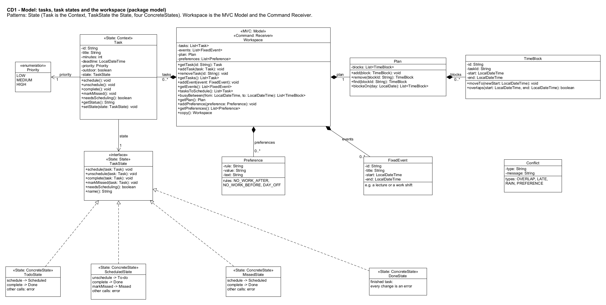
*CD1. Model.*

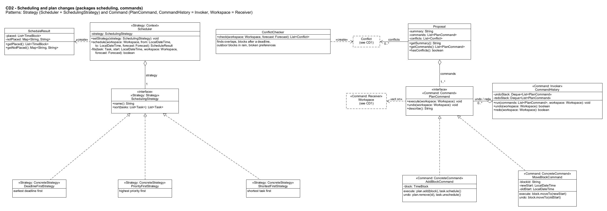
*CD2. Scheduling and plan changes.*

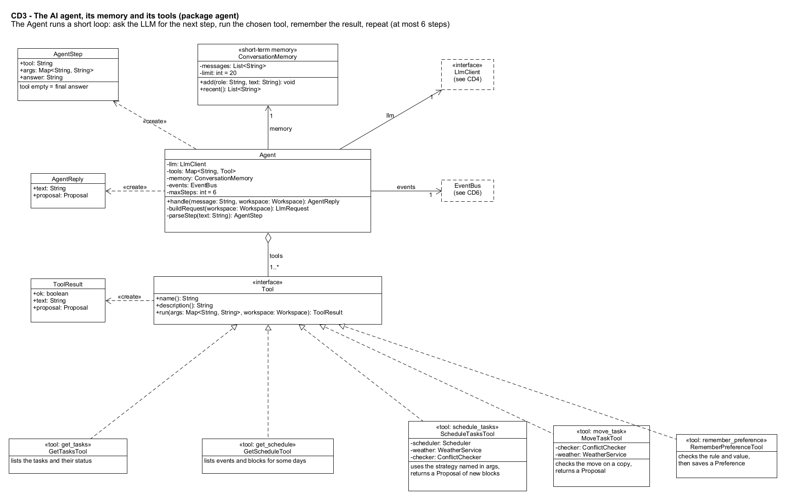
*CD3. Agent, memory and tools.*

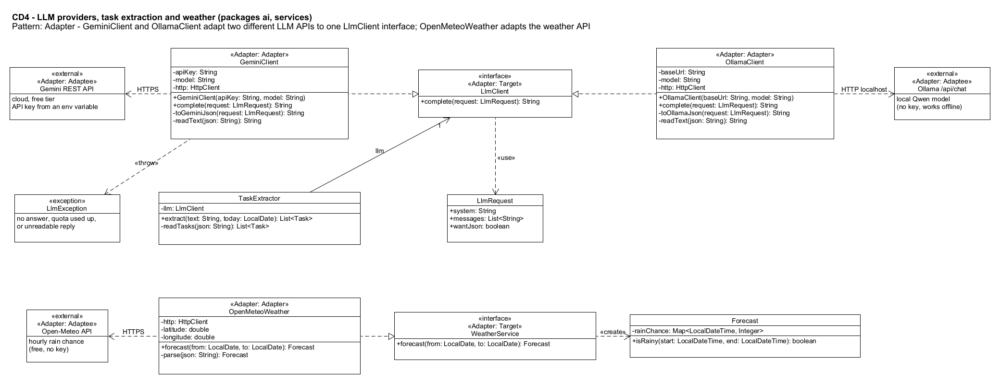
*CD4. LLM and weather adapters.*

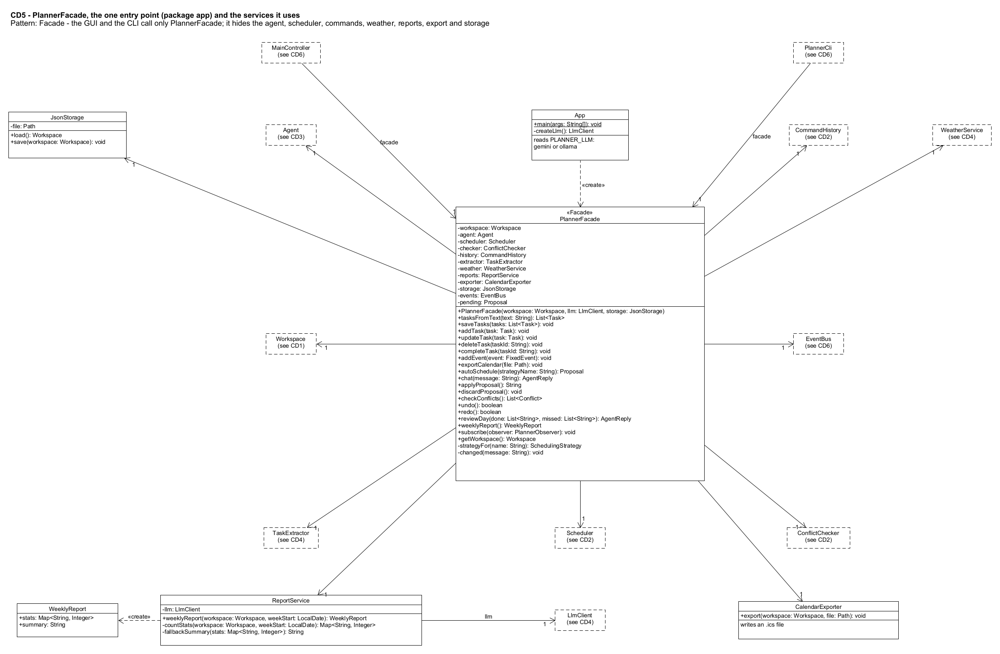
*CD5. Facade and services.*

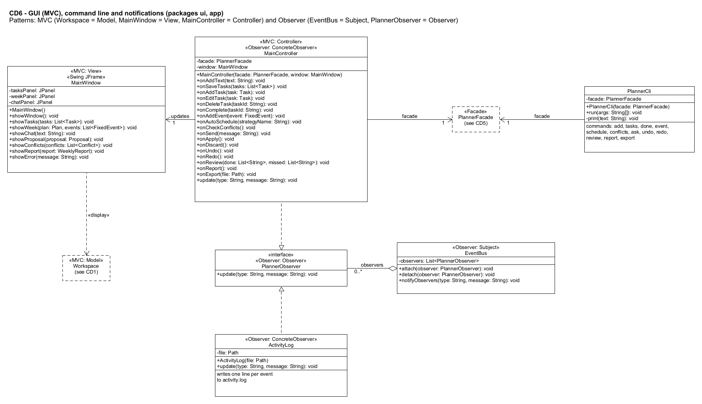
*CD6. GUI, command line and notifications.*

### 3.1 Main relationships and multiplicities

| Relationship | Kind | Multiplicity | Meaning |
|---|---|---|---|
| `Workspace` has `Task`, `FixedEvent`, `Preference` | composition | 1 to 0..* | The workspace owns the student's data |
| `Workspace` has `Plan`, `Plan` has `TimeBlock` | composition | 1 to 1, 1 to 0..* | The plan owns its blocks |
| `Task` uses `TaskState` | association (State) | 1 | The task's current state |
| `TodoState`, `ScheduledState`, `MissedState`, `DoneState` implement `TaskState` | realization | n/a | One class per state |
| `Scheduler` has a `SchedulingStrategy` | aggregation (Strategy) | 1 | Can be changed at run time |
| 3 strategy classes implement `SchedulingStrategy` | realization | n/a | Interchangeable algorithms |
| `Proposal` holds `PlanCommand`s, `CommandHistory` keeps them | aggregation (Command) | 1..* and 0..* | Changes waiting, and changes done |
| `AddBlockCommand`, `MoveBlockCommand` implement `PlanCommand` | realization | n/a | Concrete commands |
| `Agent` has `Tool`s and one `ConversationMemory` | aggregation, association | 1..* and 1 | Tools and short-term memory |
| 5 tool classes implement `Tool` | realization | n/a | The agent's actions |
| `GeminiClient`, `OllamaClient` implement `LlmClient` | realization (Adapter) | n/a | Two providers, one interface |
| `OpenMeteoWeather` implements `WeatherService` | realization (Adapter) | n/a | Weather API behind an interface |
| `PlannerFacade` uses the subsystems | association (Facade) | 1 each | One entry point |
| `EventBus` keeps `PlannerObserver`s | aggregation (Observer) | 0..* | Who is notified |
| `MainController`, `ActivityLog` implement `PlannerObserver` | realization | n/a | Concrete observers |
| `MainController` uses `MainWindow` and `PlannerFacade` | association (MVC) | 1 each | Controller between view and model |

**Normal software parts:** the model, the scheduler, the conflict check, the commands, the facade, the storage, the GUI and the CLI. **AI and agent parts:** `Agent`, `ConversationMemory`, `AgentStep`, `AgentReply`, the `Tool` classes, `LlmClient`, `GeminiClient`, `OllamaClient`, `TaskExtractor` and `ReportService`.

---

## 4. Design patterns

PlannedAgent uses 7 patterns. All of them are taught in this course's slides (structural, behavioural and architecture lectures), and each one solves a real problem in this app.

| # | Pattern | Classes (role) | Features |
|---|---|---|---|
| P1 | Strategy | `Scheduler` (Context), `SchedulingStrategy` (Strategy), `DeadlineFirstStrategy`, `PriorityFirstStrategy`, `ShortestFirstStrategy` (ConcreteStrategy) | F04, F05, F10 |
| P2 | State | `Task` (Context), `TaskState` (State), `TodoState`, `ScheduledState`, `MissedState`, `DoneState` (ConcreteState) | F02, F04, F10 |
| P3 | Command | `PlanCommand` (Command), `AddBlockCommand`, `MoveBlockCommand` (ConcreteCommand), `CommandHistory` (Invoker), `Workspace` (Receiver), `PlannerFacade` (Client) | F04, F05, F07, F10 |
| P4 | Observer | `EventBus` (Subject), `PlannerObserver` (Observer), `MainController`, `ActivityLog` (ConcreteObserver) | F01, F02, F05, F07, F10 |
| P5 | Adapter | `LlmClient` (Target), `GeminiClient`, `OllamaClient` (Adapter), Gemini and Ollama APIs (Adaptee); `WeatherService` (Target), `OpenMeteoWeather` (Adapter), Open-Meteo API (Adaptee) | F01, F05, F07 to F11 |
| P6 | Facade | `PlannerFacade` (Facade), `MainController` and `PlannerCli` (clients), agent, scheduler, commands and services (subsystems) | all |
| P7 | MVC | `Workspace` (Model, reached through the facade), `MainWindow` (View), `MainController` (Controller) | all GUI features |

### P1: Strategy (how tasks are ordered)

* **Problem.** There are several sensible ways to decide which task gets a slot first: by deadline, by priority, or shortest first. The student picks one in the GUI, and the agent picks one by name. Writing all of them as `if/else` inside `Scheduler` would mix several algorithms in one class.
* **Classes and roles.**
  * `Scheduler` is the Context: it keeps a `SchedulingStrategy` and has `setStrategy()`.
  * `SchedulingStrategy` is the Strategy interface, with `sort(tasks)`.
  * The three strategy classes are the ConcreteStrategies.
  * `PlannerFacade.strategyFor(name)` turns a name into a strategy object.
* **Why this pattern.** The three algorithms do the same job in different ways and are chosen at run time. This is exactly the slides' Context and `setStrategy()` example.
* **Without it.** Every new ordering would mean editing and retesting `Scheduler`, and the orderings could not be unit-tested on their own.

### P2: State (a task's status)

* **Problem.** What a task may do depends on its status:
  * a Done task cannot be scheduled;
  * a To-do task cannot be "missed";
  * a Missed task must be rescheduled.

  Without a pattern, `switch (status)` code would appear in the task, the scheduler and the review.
* **Classes and roles.**
  * `Task` is the Context. It keeps its current `TaskState`, sends each call to it (`schedule()`, `complete()`, `markMissed()`, `unschedule()`) and has `setState()`.
  * `TaskState` is the State interface.
  * `TodoState`, `ScheduledState`, `MissedState` and `DoneState` are the ConcreteStates. Each one decides which calls are allowed and moves the task to the next state; a call that is not allowed throws `IllegalStateException`.
* **Why this pattern.** The rules for each status sit in one small class, as in the slides' context and state example. `needsScheduling()` lets the scheduler ask a task directly instead of checking its status.
* **Without it.** The same rules would be copied in several places, and it would be easy to forget one, for example rescheduling a task that is already done.

### P3: Command (plan changes with confirmation and undo)

* **Problem.** A change to the plan must be shown first, applied only when the student agrees, and undone if needed. Changes come from three places: auto-schedule, the agent, and the end-of-day review. The AI must not change data directly.
* **Classes and roles.**
  * `PlanCommand` is the Command, with `execute()`, `undo()` and `describe()`.
  * `AddBlockCommand` and `MoveBlockCommand` are the ConcreteCommands.
  * `CommandHistory` is the Invoker: it runs the commands and keeps undo and redo stacks.
  * `Workspace` (with its `Plan`) is the Receiver.
  * `PlannerFacade` is the Client.
  * A `Proposal` holds the commands until the student clicks Apply.
* **Why this pattern.** It turns a change into an object that can be shown, tried on a copy, run, and reversed. The slides name undo as a main use of Command.
* **Without it.** There would be no safe preview and no undo, and a wrong AI answer would edit the student's plan directly.

### P4: Observer (notifications)

* **Problem.** When the plan changes or the agent uses a tool, several parts must react:
  * the window refreshes;
  * the chat status line updates;
  * the activity log records the event.

  The facade and the agent should not need to know about any of them.
* **Classes and roles.**
  * `EventBus` is the Subject, with `attach()`, `detach()` and `notifyObservers()`.
  * `PlannerObserver` is the Observer interface, with `update(type, message)`.
  * `MainController` (refreshes the window) and `ActivityLog` (writes a line to a file) are the ConcreteObservers.
* **Why this pattern.** It gives one-to-many notification with loose coupling, matching the Subject, Observer, `attach` and `update` structure in the slides.
* **Without it.** `PlannerFacade` would call the Swing window directly, so the logic would depend on the GUI, and adding the log would mean editing the facade.

### P5: Adapter (LLM providers and the weather API)

* **Problem.** Gemini's web API and Ollama's web API take different request formats and return different JSON. Open-Meteo returns its own JSON too. The student wants to switch between Gemini and a local Qwen model with one setting.
* **Classes and roles.**
  * LLM:
    * `LlmClient` is the Target, with one method, `complete(request)`.
    * `GeminiClient` and `OllamaClient` are object adapters: each holds an `HttpClient` and translates our request into the provider's format and back (`toGeminiJson()`, `readText()`).
    * The two web APIs are the Adaptees.
  * Weather: `WeatherService` (Target), `OpenMeteoWeather` (Adapter), Open-Meteo API (Adaptee).
  * The clients are `Agent`, `TaskExtractor`, `ReportService`, `PlannerFacade` and `ScheduleTasksTool`.
* **Why this pattern.** The rest of the code only knows `complete(request)` and `forecast(from, to)`. Switching to the local model changes one line in `App.createLlm()`, and nothing else.
* **Without it.** Provider-specific JSON would appear in many classes, switching models would mean editing all of them, and tests could not use a fake LLM.

### P6: Facade (one entry point)

* **Problem.** Both the GUI and the CLI need about 15 operations, and each operation involves several subsystems. For example, auto-schedule uses the strategy, the weather, the scheduler, the commands and the conflict check.
* **Classes and roles.**
  * `PlannerFacade` is the Facade, with `chat()`, `autoSchedule()`, `applyProposal()`, `undo()`, `reviewDay()`, `weeklyReport()` and others.
  * The subsystems are `Agent`, `Scheduler`, `ConflictChecker`, `CommandHistory`, `TaskExtractor`, `WeatherService`, `ReportService`, `CalendarExporter`, `JsonStorage`, `EventBus` and `Workspace`.
  * The clients are `MainController` and `PlannerCli`.
* **Why this pattern.** It gives a unified interface to a set of subsystems, as the slides define a facade. The GUI and the CLI get exactly the same behaviour, and the Stage 3 test harness can call the agent through the same door.
* **Without it.** The same logic would be repeated in the GUI and the CLI, and the user interface would depend on every subsystem.

### P7: MVC (GUI structure)

* **Problem.** The window must show the data and let the student change it, without holding any planning logic, so that the same logic also serves the CLI.
* **Classes and roles.**
  * `Workspace` is the Model, reached through `PlannerFacade`.
  * `MainWindow` is the View: it only draws, with `showTasks()`, `showWeek()`, `showProposal()` and similar methods.
  * `MainController` is the Controller: it handles button clicks (`onSend()`, `onApply()` and so on), calls the facade and updates the view. It also observes model changes through P4.
* **Why this pattern.** It is the standard GUI architecture from the course. It keeps Swing code apart from logic, so the view could be replaced later (for example by a phone screen) without touching the model.
* **Without it.** Planning code would sit inside Swing button handlers, could not be tested without the GUI, and would have to be written again for the CLI.

---

## 5. Use-case diagram

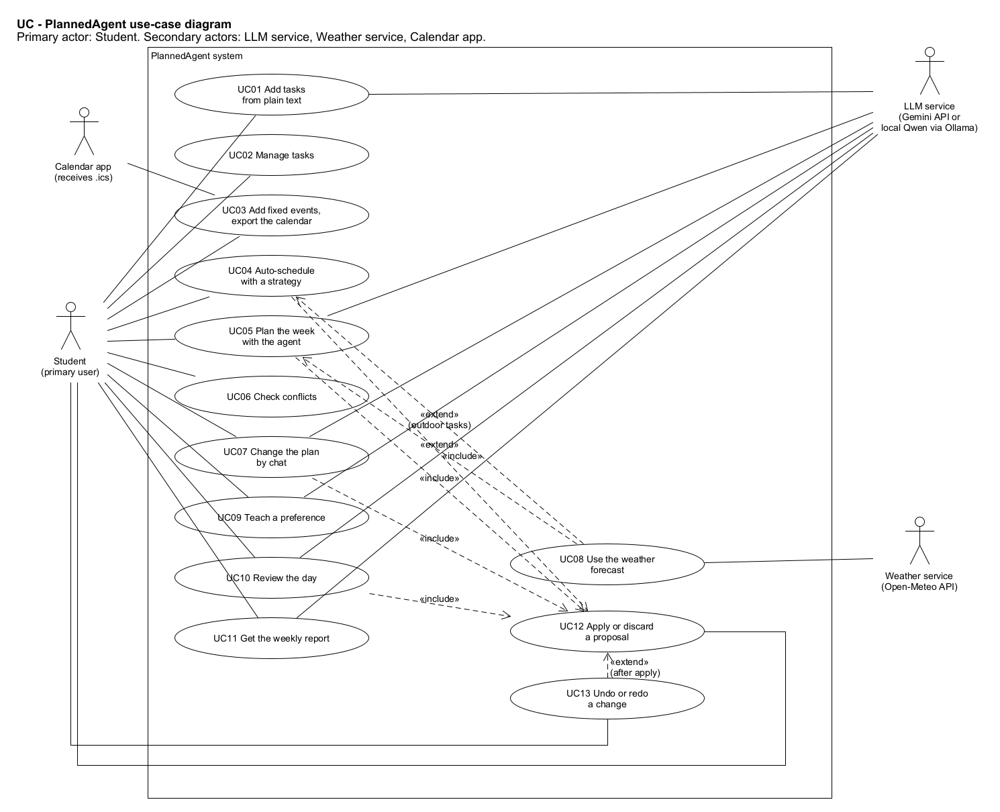
*Figure 2. Use-case diagram (UMLet file [`UC-use-case-diagram.uxf`](diagrams/uxf/UC-use-case-diagram.uxf)).*

**Actors.**

* **Student.** The primary actor, who uses the system.
* **LLM service.** The Gemini API or the local Qwen model through Ollama. It takes part in UC01, UC05, UC07, UC09, UC10 and UC11.
* **Weather service.** The Open-Meteo API, in UC08.
* **Calendar app.** Receives the exported `.ics` file in UC03.

**Relationships.**

* UC04, UC05, UC07 and UC10 include UC12, the shared step of applying or discarding a proposal.
* UC08 extends UC04 and UC05 when outdoor tasks are involved.
* UC13 (undo or redo) extends UC12 after a change is applied.

The 13 use cases cover all 11 features (see Section 8).

---

## 6. Use-case descriptions

### UC01: Add tasks from plain text
* **Actors:** Student (primary), LLM service.
* **Goal:** Turn one sentence into tasks.
* **Preconditions:** The app is running.
* **Trigger:** The student types in the task text box and clicks Add from text (or runs `plannedagent add`).
* **Main success scenario:**
  1. The student enters the text.
  2. The system sends it to the LLM.
  3. The system reads the JSON reply into tasks.
  4. The system checks each task (title, length, deadline).
  5. The system shows the tasks.
  6. The student corrects them if needed and clicks Save.
  7. The system saves the tasks as To-do.
* **Alternative/exception flows:** 1a. Empty text: rejected. 2a. LLM not available: message, and the student uses the normal form (UC02). 3a. Reply is not valid JSON: error, nothing saved. 4a. A task has a problem: it is highlighted.
* **Postconditions:** The new tasks are in the workspace and saved to the file.
* **Related features:** F01, F02.

### UC02: Manage tasks
* **Actors:** Student.
* **Goal:** Keep the task list correct.
* **Preconditions:** The app is running.
* **Trigger:** The student uses New, Edit, Delete or Mark done (or `plannedagent tasks` and `done`).
* **Main success scenario:**
  1. The student adds or edits a task.
  2. The system checks the fields and saves the task.
  3. The student marks a task as done.
  4. The task's state object allows the change and moves the task to Done.
  5. The system saves the change and refreshes the views.
* **Alternative/exception flows:** 2a. Empty title or a length of 0: rejected. 4a. The change is not allowed (for example the task is already done): message, nothing changes. 1a. Unknown id: message.
* **Postconditions:** Task data and statuses follow the lifecycle rules.
* **Related features:** F02.

### UC03: Add fixed events and export the calendar
* **Actors:** Student (primary), Calendar app.
* **Goal:** Record busy times, and get the plan into a normal calendar.
* **Preconditions:** The app is running.
* **Trigger:** Add event or Export .ics (or `plannedagent event add` and `export`).
* **Main success scenario:**
  1. The student enters an event's title, day, start and end.
  2. The system checks the times and saves the event.
  3. The student chooses Export and a file name.
  4. The system writes the events and blocks of the week to the `.ics` file.
  5. The student opens the file in their calendar app.
* **Alternative/exception flows:** 2a. End before start: rejected. 2b. Overlaps another event: saved, then reported by the conflict check. 4a. File cannot be written: error.
* **Postconditions:** The scheduler treats the event as busy time; the file exists.
* **Related features:** F03.

### UC04: Auto-schedule with a strategy
* **Actors:** Student (primary); Weather service (through UC08).
* **Goal:** Place all waiting tasks in free time without using the AI.
* **Preconditions:** Some tasks need a time slot.
* **Trigger:** The student picks a strategy and clicks Auto-schedule (or `plannedagent schedule`).
* **Main success scenario:**
  1. The system selects the strategy.
  2. The system gets the forecast if there are outdoor tasks (UC08).
  3. The system orders the tasks with the strategy.
  4. For each task, the system finds the first start time that fits: free, before the deadline, allowed by the preferences, and dry for outdoor tasks.
  5. The system builds a proposal and checks it for conflicts.
  6. The system shows the proposal and the tasks that did not fit.
  7. The student applies or discards it (includes UC12).
* **Alternative/exception flows:** 1a. Unknown strategy: deadline first, with a warning. 2a. Weather not available: continue and warn. 4a. No slot fits: the task is listed with a reason.
* **Postconditions:** A proposal is ready; after UC12 the plan is updated and can be undone.
* **Related features:** F04, F08, F09.

### UC05: Plan the week with the agent
* **Actors:** Student (primary), LLM service; Weather service (through UC08).
* **Goal:** Get a plan from a normal-language request.
* **Preconditions:** Tasks exist; an LLM is set up.
* **Trigger:** The student sends a planning request in the chat (or `plannedagent ask`).
* **Main success scenario:**
  1. The student sends the request.
  2. The agent adds it to its memory.
  3. The agent asks the LLM for the next step.
  4. The agent runs the chosen tool (for example `get_tasks`, `get_schedule`, `schedule_tasks`) and stores the result.
  5. Steps 3 and 4 repeat until the LLM gives a final answer, at most 6 steps.
  6. The system shows the answer and the proposal.
  7. The student applies or discards it (includes UC12).
* **Alternative/exception flows:** 3a. Reply is not valid JSON: the agent asks for the right format and tries again. 4a. A tool returns an error: the LLM sees it and tries again or asks the student. 5a. 6 steps used, or the LLM is not available: "I could not finish, try Auto-schedule" (UC04). 3b. Unclear request: the agent asks a question. 4b. Outdoor tasks: UC08 extends this use case.
* **Postconditions:** A proposal is waiting for the student.
* **Related features:** F05.

### UC06: Check conflicts
* **Actors:** Student.
* **Goal:** See what is wrong with the plan.
* **Preconditions:** A plan exists.
* **Trigger:** Check conflicts (or `plannedagent conflicts`).
* **Main success scenario:**
  1. The system checks for overlaps, late blocks, outdoor blocks in rain and broken preferences.
  2. The system shows the list and highlights the blocks.
  3. The student can ask the agent to fix a problem (UC07).
* **Alternative/exception flows:** 1a. No problems: "No conflicts found". 1b. No forecast: rain check skipped, with a note.
* **Postconditions:** The student knows about every problem.
* **Related features:** F06, F08.

### UC07: Change the plan by chat
* **Actors:** Student (primary), LLM service.
* **Goal:** Change the plan by asking in normal language.
* **Preconditions:** The plan has blocks.
* **Trigger:** A chat message such as "Move gym to Wednesday at 7am".
* **Main success scenario:**
  1. The agent reads the schedule with `get_schedule`.
  2. The agent calls `move_task` with the block id and the new time.
  3. The tool checks the arguments, tries the move on a copy of the workspace and checks for conflicts.
  4. The system shows the proposal.
  5. The student applies it (includes UC12).
* **Alternative/exception flows:** 3a. Unknown block or bad time: the tool returns an error without changing anything, and the agent asks which block was meant. 3b. The move would cause a conflict: shown, and Apply is blocked.
* **Postconditions:** The plan is changed, and the change can be undone (UC13).
* **Related features:** F07, F06.

### UC08: Use the weather forecast
* **Actors:** Weather service (secondary). It runs as part of UC04 and UC05.
* **Goal:** Keep outdoor tasks out of rainy hours.
* **Preconditions:** A location is set; an outdoor task exists.
* **Trigger:** Scheduling with an outdoor task (the extension point of UC04 and UC05).
* **Main success scenario:**
  1. The system asks Open-Meteo for the hourly chance of rain.
  2. The scheduler only places outdoor tasks in hours below the limit.
  3. The conflict check flags outdoor blocks in rain.
* **Alternative/exception flows:** 1a. API not reachable: continue without rain data and warn the student. 1b. Day beyond the forecast: no rain check for that day.
* **Postconditions:** Outdoor blocks are in dry hours or flagged.
* **Related features:** F08.

### UC09: Teach a preference
* **Actors:** Student (primary), LLM service.
* **Goal:** Make the agent remember a personal rule.
* **Preconditions:** None.
* **Trigger:** The student states a rule in the chat.
* **Main success scenario:**
  1. The student writes a rule ("I never study after 10pm").
  2. The agent calls `remember_preference` with a rule and a value.
  3. The tool checks them and saves the preference.
  4. The agent confirms.
  5. Later plans obey the rule.
* **Alternative/exception flows:** 3a. Unknown rule or bad time: the tool returns an error, and the agent asks again. 3b. The same rule again: the new value replaces the old one.
* **Postconditions:** The preference is saved and used by the scheduler and the conflict check.
* **Related features:** F09.

### UC10: Review the day
* **Actors:** Student (primary), LLM service.
* **Goal:** Close the day and find new times for missed tasks.
* **Preconditions:** Today has planned blocks.
* **Trigger:** Review today (or `plannedagent review`).
* **Main success scenario:**
  1. The system lists today's blocks.
  2. The student marks each one Done or Missed.
  3. The system completes the done tasks, marks the missed tasks as Missed and removes their blocks.
  4. The agent proposes new times for the missed tasks.
  5. The student applies the proposal (includes UC12).
* **Alternative/exception flows:** 1a. No blocks today: "Nothing to review". 4a. LLM not available: plain auto-schedule (deadline first) is used. 4b. A missed task is past its deadline: it is listed so the student can change the deadline.
* **Postconditions:** Today's statuses are recorded and missed tasks have proposed new times.
* **Related features:** F10, F02.

### UC11: Get the weekly report
* **Actors:** Student (primary), LLM service.
* **Goal:** See how the week went.
* **Preconditions:** The week has some data.
* **Trigger:** Weekly report (or `plannedagent report`).
* **Main success scenario:**
  1. The system counts minutes planned and done, tasks done and missed, and the busiest day.
  2. The LLM writes a short summary from those numbers.
  3. The system shows the numbers and the summary.
* **Alternative/exception flows:** 1a. No data: "No tasks were planned this week". 2a. LLM not available: a template summary is used.
* **Postconditions:** The report is shown.
* **Related features:** F11.

### UC12: Apply or discard a proposal (included)
* **Actors:** Student.
* **Goal:** Accept or reject a set of planned changes safely.
* **Preconditions:** UC04, UC05, UC07 or UC10 produced a proposal.
* **Trigger:** Apply or Discard (CLI: answer yes or no).
* **Main success scenario:**
  1. The student reads the changes and any conflicts, and clicks Apply.
  2. The system checks that the proposal has no conflicts.
  3. The command history runs every command; the tasks move to Scheduled.
  4. The system saves the workspace and notifies the observers.
  5. The window refreshes and the activity log records the change.
* **Alternative/exception flows:** 1a. Discard: nothing changes. 2a. The proposal has conflicts: Apply is refused with a message.
* **Postconditions:** Either nothing changed, or every change was applied and can be undone.
* **Related features:** F04, F05, F07, F10.

### UC13: Undo or redo a change
* **Actors:** Student.
* **Goal:** Reverse or repeat the last applied change.
* **Preconditions:** A change was applied (for undo) or undone (for redo).
* **Trigger:** Undo or Redo (or `plannedagent undo` and `redo`).
* **Main success scenario:**
  1. The student clicks Undo.
  2. The command history undoes the last group of commands in reverse order.
  3. The group moves to the redo stack.
  4. The system notifies the observers and the window refreshes.
* **Alternative/exception flows:** 2a. Nothing to undo: "Nothing to undo". After a new change, the redo stack is emptied.
* **Postconditions:** The plan is back to its previous state.
* **Related features:** F07.

---

## 7. Sequence diagrams

The nine sequence diagrams cover every feature and use case. Each one shows:

* the actor and the GUI or CLI objects;
* the controller and the facade;
* the domain objects, the agent and the LLM;
* outside services;
* the method calls in order, with the important return values and the error paths (`alt`, `opt`, `loop` and `ref` frames).

Every call uses a method that exists in the class diagrams.

| SD | What it shows | Features / use cases | Patterns seen |
|---|---|---|---|
| SD1 | Start-up: choosing the LLM and connecting the objects | all (setup) | Adapter, Facade, Observer |
| SD2 | Add tasks from plain text | F01, F02 / UC01, UC02 | Facade, MVC, Observer |
| SD3 | Auto-schedule with a strategy, the weather and preferences | F04, F08, F09 / UC04, UC08 | Strategy, Adapter, Command |
| SD4 | The agent plans the week | F05 / UC05 | Facade, Observer |
| SD5 | Apply a proposal, then undo it | F07, F02 / UC12, UC13 | Command, State, Observer |
| SD6 | Check conflicts, then fix one by chat | F06, F07 / UC06, UC07 | Command (proposal) |
| SD7 | Teach the agent a preference | F09 / UC09 | Facade |
| SD8 | End-of-day review and rescheduling | F10 / UC10 | State, Strategy (fallback) |
| SD9 | Fixed events, calendar export and weekly report from the CLI | F03, F11 / UC03, UC11 | Facade |

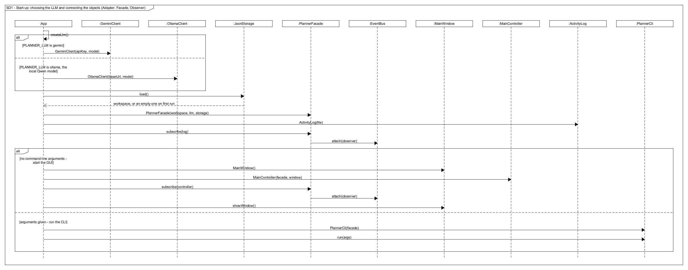
*SD1. `App` picks `GeminiClient` or `OllamaClient` from the setting, loads the workspace, creates the facade and attaches the observers. With no arguments it opens the GUI; otherwise it runs the CLI.*

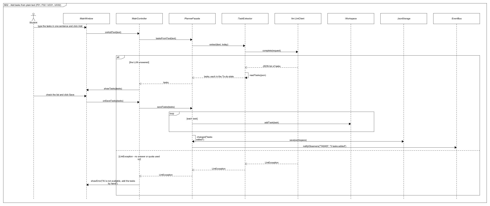
*SD2. The LLM extracts the tasks, the student checks them, the facade saves them and notifies the observers. If the LLM fails, the student adds the tasks by hand.*

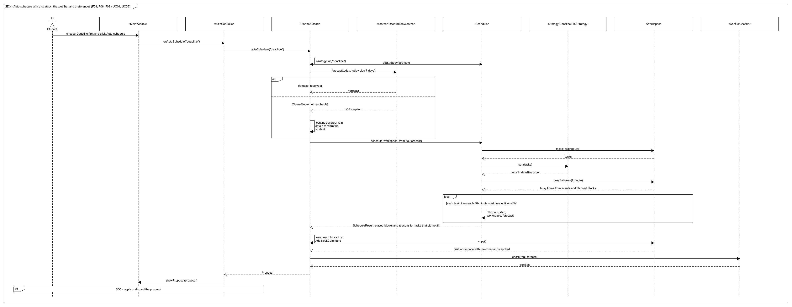
*SD3. The facade sets the strategy and gets the forecast (with a path for when it fails). The scheduler sorts the tasks and tries start times with `fits()`. The result is turned into commands, checked on a copy, and returned as a proposal.*

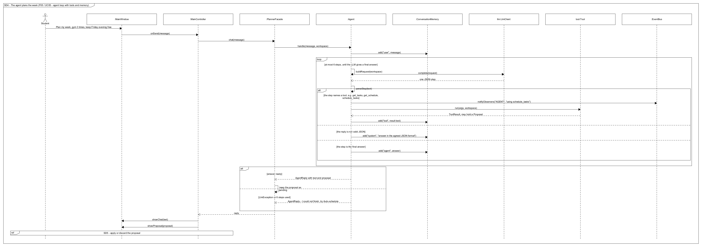
*SD4. The agent loop: build the request, call the LLM, read the step, run the tool, store the result. It ends with a proposal, or with a clear failure message.*

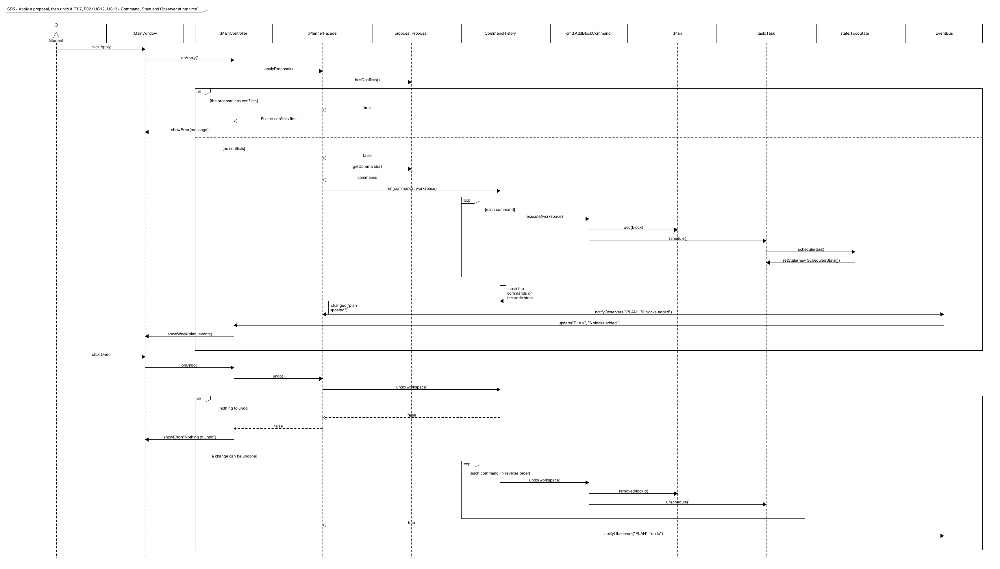
*SD5. Apply runs the commands through `CommandHistory`; each `AddBlockCommand` adds a block and moves its task from To-do to Scheduled through the State objects; the observers refresh the window. Undo reverses the commands.*

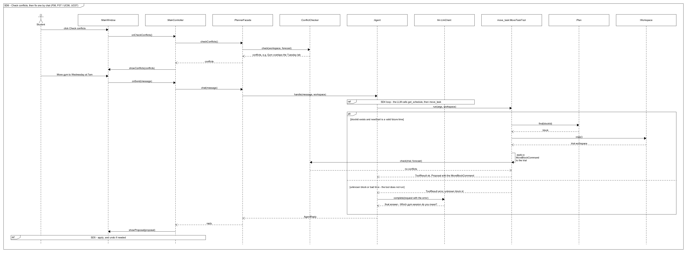
*SD6. The conflict check finds an overlap. The student asks for a move; `MoveTaskTool` checks the arguments and tries the move on a copy. Bad arguments are rejected before anything changes.*

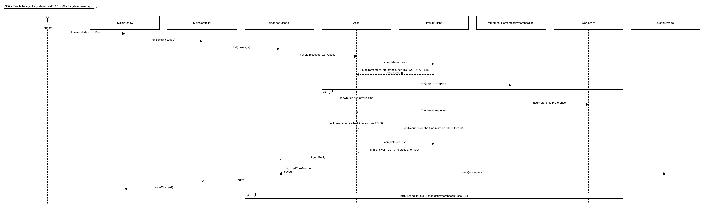
*SD7. The agent turns a sentence into a rule. The tool checks it and saves it, and the scheduler uses it later.*

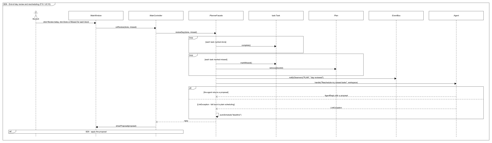
*SD8. Done and missed tasks change state, missed blocks are removed, and the agent proposes new times. If the LLM fails, plain auto-schedule is used.*

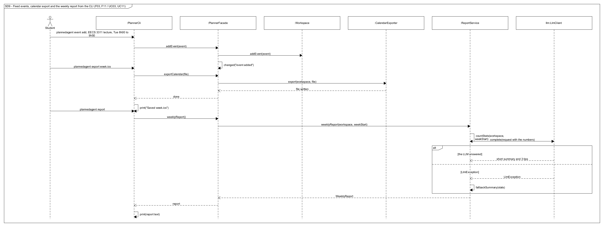
*SD9. CLI path: add a fixed event, export the calendar, and get the weekly report (with a template if the LLM fails).*

---

## 8. Feature-to-design traceability table

| Feature | Description | Type | Related use case | Classes | Key methods | Sequence diagram | Design pattern(s) |
|---|---|---|---|---|---|---|---|
| F01 | Add tasks from plain text | Hybrid | UC01 | MainWindow, MainController, PlannerFacade, TaskExtractor, LlmClient, Workspace, JsonStorage, EventBus | `onAddText()`, `tasksFromText()`, `extract()`, `complete()`, `readTasks()`, `saveTasks()`, `addTask()`, `save()` | SD2 | Facade, Adapter, MVC, Observer |
| F02 | Manage tasks and their status | Deterministic | UC02 | MainController, PlannerFacade, Workspace, Task, TaskState, TodoState, ScheduledState, MissedState, DoneState | `onAddTask()`, `onEditTask()`, `onDeleteTask()`, `addTask()`, `updateTask()`, `deleteTask()`, `removeTask()`, `onComplete()`, `completeTask()`, `getTask()`, `complete()`, `setState()` | SD2, SD5, SD8 | State, Facade |
| F03 | Fixed events and calendar export | Deterministic | UC03 | PlannerCli, MainController, PlannerFacade, Workspace, FixedEvent, CalendarExporter | `addEvent()`, `exportCalendar()`, `export()` | SD9 | Facade |
| F04 | Auto-schedule with a strategy | Deterministic | UC04, UC12 | MainController, PlannerFacade, Scheduler, SchedulingStrategy (3), ScheduleResult, AddBlockCommand, ConflictChecker, Proposal | `autoSchedule()`, `strategyFor()`, `setStrategy()`, `schedule()`, `sort()`, `fits()`, `copy()`, `check()` | SD3, SD5 | Strategy, Command, Facade |
| F05 | Plan the week with the agent | AI agent | UC05, UC12 | MainController, PlannerFacade, Agent, ConversationMemory, LlmClient, Tool (5 tools), ToolResult, AgentReply, EventBus | `onSend()`, `chat()`, `handle()`, `buildRequest()`, `complete()`, `parseStep()`, `run()`, `add()` | SD4, SD5 | Facade, Adapter, Observer, Command |
| F06 | Check conflicts | Deterministic | UC06 | MainController, PlannerFacade, ConflictChecker, Conflict, Forecast | `onCheckConflicts()`, `checkConflicts()`, `check()`, `showConflicts()` | SD6 | Facade |
| F07 | Change the plan by chat, with undo and redo | Hybrid | UC07, UC12, UC13 | Agent, MoveTaskTool, Plan, Workspace, ConflictChecker, MoveBlockCommand, CommandHistory, Proposal | `handle()`, `run()`, `find()`, `copy()`, `check()`, `execute()`, `undo()`, `redo()`, `moveTo()` | SD6, SD5 | Command, Facade |
| F08 | Weather-aware scheduling | Hybrid | UC08 | PlannerFacade, WeatherService, OpenMeteoWeather, Forecast, Scheduler, ConflictChecker | `forecast()`, `parse()`, `isRainy()`, `fits()`, `check()` | SD3 | Adapter, Strategy |
| F09 | Remember preferences | Hybrid | UC09 | Agent, RememberPreferenceTool, Workspace, Preference, JsonStorage, Scheduler | `handle()`, `run()`, `addPreference()`, `getPreferences()`, `save()`, `fits()` | SD7 | Facade |
| F10 | End-of-day review | Hybrid | UC10, UC12 | MainController, PlannerFacade, Task, TaskState, Plan, EventBus, Agent | `onReview()`, `reviewDay()`, `complete()`, `markMissed()`, `remove()`, `notifyObservers()`, `handle()`, `autoSchedule()` | SD8, SD5 | State, Observer, Strategy |
| F11 | Weekly report | Hybrid | UC11 | PlannerCli, MainController, PlannerFacade, ReportService, LlmClient, WeeklyReport | `weeklyReport()`, `countStats()`, `complete()`, `fallbackSummary()` | SD9 | Facade, Adapter |

---

## 9. How each feature is realized

### F01: Add tasks from plain text
**Related use case:** UC01. **Related sequence diagram:** SD2.

**Classes involved:**
* `MainWindow` takes the text and shows the result.
* `MainController` passes the click to the facade.
* `PlannerFacade` is the entry point.
* `TaskExtractor` asks the LLM and turns the JSON into `Task` objects.
* `LlmClient` (`GeminiClient` or `OllamaClient`) talks to the model.
* `Workspace` and `JsonStorage` keep and save the tasks.
* `EventBus` tells the window to refresh.

**Important methods:** `MainController.onAddText()`, `PlannerFacade.tasksFromText()`, `TaskExtractor.extract()`, `LlmClient.complete()`, `TaskExtractor.readTasks()`, `PlannerFacade.saveTasks()`, `Workspace.addTask()`, `JsonStorage.save()`.

**Execution:**
1. When the student clicks Add from text, `onAddText()` calls `tasksFromText()`.
2. `extract()` sends the sentence and today's date to the LLM and asks for a JSON list of tasks.
3. `readTasks()` turns the JSON into `Task` objects in the To-do state, rejecting tasks with a missing title or a length outside 5 to 600 minutes.
4. The window shows the list. On Save, `saveTasks()` adds each task to the `Workspace`, saves the file and notifies the observers.

### F02: Manage tasks and their status
**Related use case:** UC02. **Related sequence diagrams:** SD2, SD5, SD8.

**Classes involved:**
* `MainController` and `PlannerFacade` handle the request.
* `Workspace` finds the task.
* `Task` is the State context.
* `TodoState`, `ScheduledState`, `MissedState` and `DoneState` hold the rules for each status.

**Important methods:** `PlannerFacade.completeTask()`, `Workspace.getTask()`, `Task.complete()`, `TaskState.complete(task)`, `Task.setState()`.

**Execution:**
1. When the student clicks Mark done, `completeTask()` finds the task and calls `Task.complete()`.
2. The task does not decide by itself: it calls `complete(this)` on its current state object.
3. `TodoState`, `ScheduledState` and `MissedState` call `task.setState(new DoneState())`. `DoneState` throws an `IllegalStateException`, which the window shows as a message.
4. The same idea is used when a task is scheduled (SD5) or missed (SD8).

### F03: Fixed events and calendar export
**Related use case:** UC03. **Related sequence diagram:** SD9.

**Classes involved:**
* `PlannerCli` or `MainController` is the entry point.
* `PlannerFacade` coordinates.
* `Workspace` stores the `FixedEvent` objects.
* `CalendarExporter` writes the `.ics` file.

**Important methods:** `PlannerFacade.addEvent()`, `Workspace.addEvent()`, `PlannerFacade.exportCalendar()`, `CalendarExporter.export()`.

**Execution:**
1. `addEvent()` checks that the end is after the start, adds the event to the workspace and saves.
2. The scheduler later treats the event as busy time through `Workspace.busyBetween()`.
3. `exportCalendar()` passes the workspace to `CalendarExporter.export()`, which writes one calendar entry (VEVENT) per event and per planned block.

### F04: Auto-schedule with a chosen strategy
**Related use cases:** UC04, UC12. **Related sequence diagrams:** SD3, SD5.

**Classes involved:**
* `PlannerFacade` coordinates.
* `Scheduler` is the Strategy context; the three `SchedulingStrategy` classes order the tasks.
* `Workspace` gives the tasks and busy times.
* `WeatherService` gives the forecast.
* `ScheduleResult` holds the result.
* `AddBlockCommand` and `Proposal` package the change.
* `ConflictChecker` checks it.

**Important methods:** `PlannerFacade.autoSchedule()`, `strategyFor()`, `Scheduler.setStrategy()`, `Scheduler.schedule()`, `SchedulingStrategy.sort()`, `Scheduler.fits()`, `Workspace.copy()`, `ConflictChecker.check()`.

**Execution:**
1. `autoSchedule("deadline")` picks the strategy object and gives it to the scheduler, then asks for the forecast.
2. `schedule()` gets the tasks that need a slot and sorts them with the strategy.
3. For each task, it walks through 30-minute start times and uses `fits()` to find the first one that:
   * is free;
   * ends before the deadline;
   * respects the preferences;
   * is dry if the task is outdoor.
4. The placed blocks become `AddBlockCommand`s. The facade runs them on a copy of the workspace and checks for conflicts, then returns a `Proposal`. Nothing is changed until Apply.

### F05: Plan the week with the agent
**Related use cases:** UC05, UC12. **Related sequence diagrams:** SD4, SD5.

**Classes involved:**
* `MainController` and `PlannerFacade` handle the request.
* `Agent` runs the loop.
* `ConversationMemory` keeps the recent messages.
* `LlmClient` is the model.
* The `Tool` classes (`GetTasksTool`, `GetScheduleTool`, `ScheduleTasksTool`, `MoveTaskTool`, `RememberPreferenceTool`) are the agent's actions; each returns a `ToolResult`.
* `AgentReply` is the answer.
* `EventBus` shows progress.

**Important methods:** `PlannerFacade.chat()`, `Agent.handle()`, `Agent.buildRequest()`, `LlmClient.complete()`, `Agent.parseStep()`, `Tool.run()`, `ConversationMemory.add()`.

**Execution:**
1. `chat()` calls `Agent.handle()`, which stores the message in memory.
2. In each step, `buildRequest()` puts together the rules, the tool list, the preferences and the recent messages. The LLM answers with one JSON step, which `parseStep()` reads.
3. If the step names a tool, the agent publishes a status event, runs the tool and stores the result.
4. The loop ends when the LLM gives a final answer or after 6 steps.
5. If a tool such as `schedule_tasks` returned a `Proposal`, it is passed back in the `AgentReply` and shown with Apply and Discard.

### F06: Check conflicts
**Related use case:** UC06. **Related sequence diagram:** SD6.

**Classes involved:**
* `MainController` and `PlannerFacade` handle the request.
* `ConflictChecker` finds the problems and creates `Conflict` objects.
* `Forecast` gives the rain data.

**Important methods:** `PlannerFacade.checkConflicts()`, `ConflictChecker.check()`, `MainWindow.showConflicts()`.

**Execution:**
1. `check()` compares every pair of busy times for overlaps.
2. It compares each block with its task's deadline.
3. It asks the `Forecast` whether outdoor blocks are rainy.
4. It compares each block with the saved preferences.
5. Each problem becomes a `Conflict` with a type and a message, and the window lists them. The same check runs on every proposal before it can be applied.

### F07: Change the plan by chat, with undo and redo
**Related use cases:** UC07, UC12, UC13. **Related sequence diagrams:** SD6, SD5.

**Classes involved:**
* `Agent` runs the loop.
* `MoveTaskTool` checks the request.
* `Plan` and `Workspace` hold the blocks.
* `ConflictChecker` checks the result.
* `MoveBlockCommand` is the change itself.
* `CommandHistory` runs, undoes and redoes it.

**Important methods:** `MoveTaskTool.run()`, `Plan.find()`, `Workspace.copy()`, `ConflictChecker.check()`, `CommandHistory.run()`, `MoveBlockCommand.execute()`, `MoveBlockCommand.undo()`, `TimeBlock.moveTo()`, `CommandHistory.undo()`, `CommandHistory.redo()`.

**Execution:**
1. The LLM calls `move_task` with a block id and a new start time.
2. `run()` checks that the block exists and that the time is valid and in the future. If not, it returns an error and changes nothing.
3. Otherwise it applies a `MoveBlockCommand` to a copy of the workspace and checks it for conflicts, then returns a `Proposal`.
4. After Apply, `CommandHistory.run()` calls `execute()`, which calls `moveTo(newStart)`. Undo calls `undo()`, which moves the block back to `oldStart`.

### F08: Weather-aware scheduling
**Related use case:** UC08. **Related sequence diagram:** SD3.

**Classes involved:**
* `WeatherService` is the interface, and `OpenMeteoWeather` the adapter that calls the API and parses its JSON.
* `Forecast` answers rain questions.
* `Scheduler` and `ConflictChecker` use it.

**Important methods:** `WeatherService.forecast()`, `OpenMeteoWeather.parse()`, `Forecast.isRainy()`, `Scheduler.fits()`.

**Execution:**
1. Before scheduling, the facade calls `forecast(today, today plus 7)`.
2. `OpenMeteoWeather` sends one web request and turns the hourly rain chances into a `Forecast`.
3. For an outdoor task, `fits()` rejects any start time where `isRainy(start, end)` is true.
4. If the request fails, the facade continues with no forecast and warns the student.

### F09: Remember preferences
**Related use case:** UC09. **Related sequence diagram:** SD7.

**Classes involved:**
* `Agent` runs the loop.
* `RememberPreferenceTool` checks and saves the rule.
* `Preference` is the rule.
* `Workspace` and `JsonStorage` keep it.
* `Scheduler` and `ConflictChecker` obey it.

**Important methods:** `RememberPreferenceTool.run()`, `Workspace.addPreference()`, `JsonStorage.save()`, `Workspace.getPreferences()`, `Scheduler.fits()`.

**Execution:**
1. The LLM turns "I never study after 10pm" into `remember_preference` with rule `NO_WORK_AFTER` and value `22:00`.
2. The tool accepts only known rules and valid times; anything else returns an error so the LLM can ask again.
3. The preference is added to the workspace and saved, so it survives a restart.
4. From then on, `fits()` will not place a block that breaks it.

### F10: End-of-day review
**Related use cases:** UC10, UC12. **Related sequence diagrams:** SD8, SD5.

**Classes involved:**
* `MainController` and `PlannerFacade` handle the request.
* `Task` and its state classes record the outcome.
* `Plan` drops the missed blocks.
* `EventBus` refreshes the window.
* `Agent` proposes new times, with `PlannerFacade.autoSchedule()` as the fallback.

**Important methods:** `PlannerFacade.reviewDay()`, `Task.complete()`, `Task.markMissed()`, `Plan.remove()`, `EventBus.notifyObservers()`, `Agent.handle()`, `PlannerFacade.autoSchedule()`.

**Execution:**
1. `reviewDay(done, missed)` completes each done task. For each missed task it calls `markMissed()`, so the state object moves it from Scheduled to Missed, and removes its block.
2. It then asks the agent to "reschedule my missed tasks". The agent schedules them, for example in the morning if the student said they were too tired at night, and returns a proposal.
3. If the LLM fails, the facade uses `autoSchedule("deadline")` instead.

### F11: Weekly report
**Related use case:** UC11. **Related sequence diagram:** SD9.

**Classes involved:**
* `PlannerCli` or `MainController` is the entry point.
* `PlannerFacade` coordinates.
* `ReportService` counts and writes the report.
* `LlmClient` writes the summary text.
* `WeeklyReport` holds the result.

**Important methods:** `PlannerFacade.weeklyReport()`, `ReportService.weeklyReport()`, `countStats()`, `LlmClient.complete()`, `fallbackSummary()`.

**Execution:**
1. `countStats()` adds up the minutes planned and done, the tasks done and missed, and finds the busiest day. These are plain numbers.
2. The numbers, and only the numbers, are sent to the LLM, which writes a short summary with tips.
3. If the LLM fails, `fallbackSummary()` builds a fixed sentence from the numbers.
4. The result is a `WeeklyReport`, shown in the window or printed by the CLI.

---

## 10. Important design decisions

| # | Decision | Reason |
|---|---|---|
| D1 | Only the `ui` package uses Swing; everything else is plain Java. | The logic can be tested without a window, and it can be reused later with another screen (for example a phone app). |
| D2 | One `LlmClient` interface with two adapters: Gemini (cloud, free tier) and Qwen through Ollama (local), picked by the `PLANNER_LLM` setting. | Free to run. The local model keeps data on the laptop and has no daily limit. Switching providers changes one line. |
| D3 | The LLM does not change data directly. Tools that change the plan return a `Proposal`; the change runs as commands only after the student clicks Apply, and can be undone. | A wrong AI answer cannot damage the student's plan, and the student stays in control. |
| D4 | The agent and the LLM talk in a fixed JSON format: each reply is either one tool call or a final answer. The loop stops after 6 steps, and each tool checks its own arguments before doing anything. | Works the same way with both models. Small free models stay usable, and the agent cannot loop forever. |
| D5 | Exact work is done in Java, not by the LLM: free slots, deadlines, overlaps, preferences, rain, and the counts in the report. | LLMs are bad at exact sums and dates. Plain code can be unit-tested. |
| D6 | Every AI feature has a fallback: the manual task form, plain auto-schedule, and a template report. | The app stays useful when the free quota runs out or there is no internet. |
| D7 | Two kinds of memory: `ConversationMemory` keeps the last 20 messages, and `Preference` objects are saved in the workspace file. | The conversation stays small, and the important rules are kept for good and enforced by code. |
| D8 | Data is saved in one JSON file in the student's home folder. The Gemini API key is read from an environment variable and is not written to any file. | Nothing to install for a grader, and no secrets in the repository. |
| D9 | Slow AI calls run in a Swing `SwingWorker`, and the window updates when the call ends. | The window does not freeze while the model is thinking. |
| D10 | The `plannedagent ask` command and the `ActivityLog` file give a non-GUI way to talk to the agent, plus a record of every step it took. | This prepares Stage 3, where the agent's behaviour is tested automatically. JUnit tests can also replace `LlmClient` with a fake that returns fixed answers. |

---

## 11. Stage 1 requirement checklist

| Requirement (stage1.pdf) | Where |
|---|---|
| GUI for the main functions | §1.8, CD6, SD2 to SD8 |
| CLI for the main functions | §1.8 (command table), CD6, SD9 |
| At least 10 meaningful features | §2: 11 features |
| At least 5 design patterns from the course | §4: 7 patterns, each with problem, classes, roles, reason and what would be harder without it |
| At least one AI/LLM model | §1.5: Gemini API, or local Qwen through Ollama |
| Agent behaviour: reasoning, planning, tools, memory | §1.6, CD3, SD4, SD6, SD7 |
| Project overview: problem, users, agent, models, architecture | §1.1 to §1.7 |
| Feature specs with ID, description, GUI use, input, output, AI involvement, workflow, errors | §2 |
| Class diagram: classes, interfaces, attributes, methods, relationships, multiplicities, AI parts | §3, CD0 to CD6 |
| Design pattern explanations | §4 |
| Use-case diagram covering all features | §5 |
| Use-case descriptions with all fields | §6, UC01 to UC13 |
| Sequence diagrams using the classes and methods from the class diagram | §7, SD1 to SD9 |
| Feature-to-design traceability table | §8 |
| Feature implementation explanations | §9 |
| Important design decisions | §10 |
