# PlannedAgent: Stage 1 Design Report

**EECS 3311 Software Design, Fall 2026. Course Project, Stage 1 (Software and Agent Design)**
**Author:** Milad Jafarieh
**Project:** PlannedAgent, an AI planning agent that turns a messy to-do list into a conflict-free, time-blocked week

> How to read this report. Every artefact carries an ID so it can be traced end to end:
> features `F01-F12` -> use cases `UC01-UC14` -> sequence diagrams `SD01-SD14` -> class diagrams `CD00-CD10` -> design patterns `P1-P10`.
> UML sources are UMLet files in [`diagrams/uxf/`](diagrams/uxf/), and the rendered images are in [`diagrams/png/`](diagrams/png/).
> Section 8 is the full feature-to-design traceability table.

## Contents

1. [Project overview](#1-project-overview)
2. [Feature specifications (F01-F12)](#2-feature-specifications)
3. [UML class diagram (CD00-CD10)](#3-uml-class-diagram)
4. [Design patterns (P1-P10)](#4-design-patterns)
5. [Use-case diagram](#5-use-case-diagram)
6. [Use-case descriptions (UC01-UC14)](#6-use-case-descriptions)
7. [Sequence diagrams (SD01-SD14)](#7-sequence-diagrams)
8. [Feature-to-design traceability table](#8-feature-to-design-traceability-table)
9. [How each feature is realized](#9-how-each-feature-is-realized)
10. [Important design decisions](#10-important-design-decisions)
11. [Design for testing (preview of Stages 2-3)](#11-design-for-testing)
12. [Stage 1 requirement checklist](#12-stage-1-requirement-checklist)

---

## 1. Project overview

### 1.1 Problem and motivation

Students juggle classes, assignments, part-time shifts, workouts and errands. Their tasks live in one place (a to-do list) and their time in another (a calendar), so deciding when to do each task is a manual, daily chore. That plan also breaks as soon as something changes: a sick day, a class that runs late, rain on the day of a planned run.

Existing tools cover only part of the job:

* To-do apps store tasks but do not schedule them.
* Calendars hold events but do not plan tasks into free time.
* Rule-based auto-schedulers need perfectly structured input and cannot take an instruction like *"I'm sick today, push everything non-urgent but keep my 3 pm lab."*
* General chatbots can talk about plans, but they cannot see the calendar, cannot guarantee a plan without double-booking, and sometimes invent events.

### 1.2 Target users

* Primary: university students (for example York University students), who mix fixed timetables with deadline-driven coursework, a job and personal goals.
* Secondary: busy individuals who want a weekly plan built from loose notes, without learning a complex planning tool.

### 1.3 What the agent does

PlannedAgent is a desktop application with a GUI and a CLI. Its AI agent:

1. Understands loose language. It turns a "brain dump" into structured tasks: duration, deadline, priority, category, and whether the task is outdoors.
2. Plans multi-step, with tools. It reads the tasks and the calendar, finds free time, checks the weather for outdoor tasks, runs a scheduling algorithm, checks for conflicts, and proposes a time-blocked plan. It explains the plan and lists anything that did not fit.
3. Edits the plan conversationally. For example: *"move gym to tomorrow 7 am"*, or *"I'm sick, push everything non-urgent"*. Every change is shown first, applied only after the user confirms, and can be undone.
4. Remembers the user. It keeps long-term preferences such as *"no studying after 10 pm"* or *"Sundays off"* and turns them into hard scheduling constraints.
5. Plans goals and learns from the day. It breaks a goal into milestones and tasks, reschedules missed tasks at the end of the day, and writes a weekly insights report grounded in real statistics.

### 1.4 Why an AI agent is appropriate

Planning needs two kinds of work:

* Language and judgment. This means interpreting "sometime this week", "after class", or "I'm too tired at night", choosing which information to gather, and explaining trade-offs. An LLM is good at this; fixed rules are not.
* Correctness. This means no double-booking, deadlines respected, working hours and quiet hours honoured, and dates computed exactly. Deterministic code is good at this; LLMs are not.

An agent combines the two. The LLM decides *what to do next* and calls tools, and deterministic tools do the exact work and validate every change. A single prompt to an LLM would not be enough: the agent must loop, observe tool results, recover from tool failures, and stop to ask when a request is ambiguous.

### 1.5 AI/LLM models

PlannedAgent is model-agnostic (see P2 Adapter and P3 Decorator):

| Role | Model | Why |
|---|---|---|
| Default LLM | Google Gemini API, free tier: `gemini-3.5-flash-lite` (configurable, e.g. `gemini-3.1-flash-lite`) | Free, fast, and supports JSON-schema structured output |
| Local / offline LLM | Qwen served by Ollama on the author's laptop (e.g. `qwen3:8b`) | Free, private and offline, with no quota; Ollama supports JSON-schema output |
| Test double | `ScriptedLlmClient` | Deterministic, scripted responses for automated tests (Stage 3) |

Free-tier quotas are small and change over time. The design therefore treats quota as a constraint: it caches responses, rate-limits requests, retries with back-off, and has a deterministic fallback for every AI feature. The agent is designed so that a small, cheap model is enough: the LLM gets narrow jobs with strict JSON schemas, and deterministic code does everything else.

### 1.6 How the LLM interacts with the rest of the system

* The core does not call any vendor API itself. All AI calls go through the `LlmClient` interface (CD06). The concrete adapter (`GeminiLlmClient` or `OllamaLlmClient`) is chosen from configuration by `LlmClientFactory`, which wraps it in decorators (`CachingLlmClient` -> `RetryingLlmClient` -> `RateLimitedLlmClient`).
* Agent mode (chat). `AgentController` runs a bounded ReAct loop, at most 8 steps:
  1. `PromptBuilder` builds a request containing the system rules, the tool catalogue (`ToolSpec`s), relevant remembered preferences and the recent conversation.
  2. The LLM answers with one JSON action: `ToolCallAction`, `FinalAnswerAction` or `ClarifyAction`.
  3. `ResponseParser` turns that answer into an action object.
  4. `ToolRegistry` validates the action's arguments and executes the tool.
  5. The result goes back to the model as an observation, and the loop repeats.

  This provider-neutral JSON protocol works the same way on Gemini and on local Qwen.
* Workflow mode. Task capture, goal planning and weekly insights each make one schema-constrained call through `StructuredOutputClient`. That client parses the output, validates it, and sends one repair request if the JSON is malformed.
* The LLM does not edit state directly. Plan changes come back as a `PlanProposal`: a set of `PlanCommand`s checked against a copy of the workspace. The user confirms the proposal before `CommandHistory` applies it, and every applied change can be undone.

### 1.7 Overall architecture

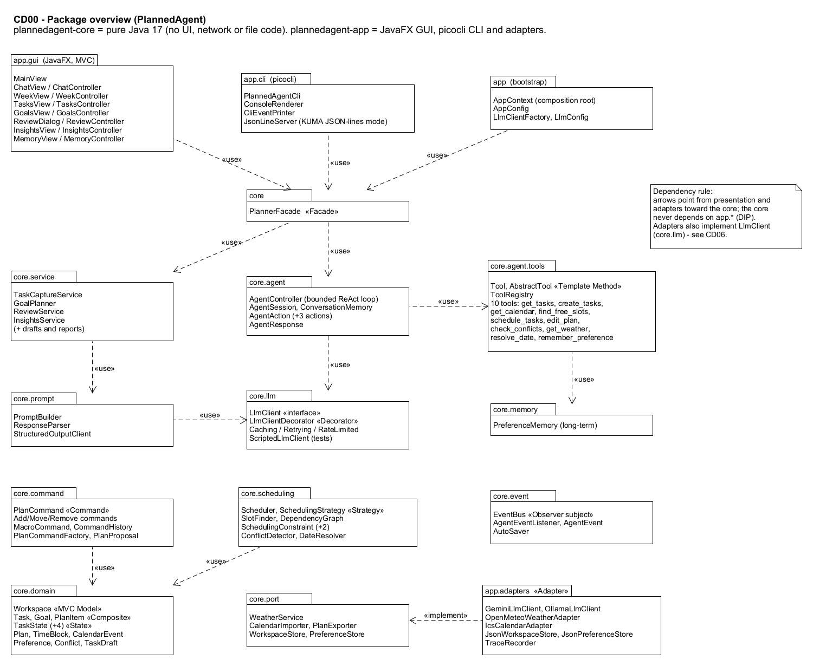
*Figure 1. CD00 package overview (source: [`CD00-package-overview.uxf`](diagrams/uxf/CD00-package-overview.uxf)).*

PlannedAgent uses a layered, ports-and-adapters architecture split into two modules:

* `plannedagent-core` (pure Java 17, with no UI, network or file code) holds:
  * the domain model
  * the deterministic scheduling engine
  * commands and events
  * the agent loop and tools
  * prompting
  * the `LlmClient` abstraction
  * port interfaces for everything external

  Because the core has no platform dependencies, it can later be reused unchanged inside an Android app.
* `plannedagent-app` (Java 21) holds:
  * the JavaFX GUI (MVC)
  * the picocli CLI
  * a JSON-lines mode (`plannedagent serve`) used by the Stage 3 KUMA test harness
  * the infrastructure adapters: Gemini, Ollama, Open-Meteo, iCalendar and JSON storage

All three front-ends call one `PlannerFacade` (P6), so the GUI and the CLI always offer the same features. Dependencies point inward: the core owns the interfaces, and the app implements them (Dependency Inversion).

### 1.8 Agent capabilities (what makes it an agent)

| Capability | Where it lives |
|---|---|
| Reasoning and planning | `AgentController` ReAct loop: thought -> tool call -> observation, until a final answer (SD04) |
| Tool use | 10 tools behind `ToolRegistry`; every call is validated before it runs (CD05, SD07) |
| Retrieval | Tasks, calendar and free slots through tools; relevant preferences through `PreferenceMemory.relevantTo()` |
| Memory | Short-term: `ConversationMemory` (last 20 turns). Long-term: `PreferenceMemory`, persisted and turned into constraints (SD09) |
| Decision making | Choosing tools and strategies, asking a clarifying question (`ClarifyAction`), refusing to apply proposals with blocking conflicts |
| Multi-step execution and recovery | Up to 8 steps per request; tool errors become observations; malformed output gets one repair attempt; deterministic fallbacks when the LLM is unavailable |

### 1.9 Interfaces: GUI and CLI

**GUI (JavaFX).** One window with the tabs Week, Tasks, Goals, Insights, Memory, Settings and a chat panel on the right.

* The Week tab shows a time grid of fixed events and planned blocks, with conflict badges and weather icons. Its toolbar holds: strategy drop-down, Auto-schedule, Check conflicts, Check weather, Review today, Undo/Redo, Import/Export `.ics`.
* The chat panel shows the conversation, a live agent status line such as "checking your calendar...", and proposal cards with Apply / Discard buttons.

**CLI (picocli).** Every major feature is also available from a terminal. `plannedagent serve` exposes the agent as JSON lines on stdin/stdout for automated (KUMA) testing.

| Feature | GUI location | CLI command |
|---|---|---|
| F01 Task capture | Tasks -> Quick capture -> Extract | `plannedagent capture "<text>" [--yes]` |
| F02 Tasks and dependencies | Tasks table, New task, Depends on..., Complete | `plannedagent tasks list\|add\|done\|reopen\|delete\|depend` |
| F03 Calendar import/export | Week -> Import .ics / Export .ics | `plannedagent import <file>` or `plannedagent export <file> --from --to` |
| F04 Agent plans the week | Chat panel | `plannedagent chat` or `plannedagent ask "<request>" [--json]` |
| F05 Auto-schedule | Week -> strategy + Auto-schedule | `plannedagent schedule --from --to --strategy edf\|priority\|peak` |
| F06 Conflicts | Week -> Problems panel -> Ask agent to fix | `plannedagent conflicts --from --to` |
| F07 Edit plan and undo/redo | Chat; Week -> Undo / Redo | `plannedagent ask "move gym..."` or `plannedagent undo` or `plannedagent redo` |
| F08 Weather | Week -> Check weather (automatic during scheduling) | `plannedagent weather --from --to` |
| F09 Preference memory | Chat; Memory tab | `plannedagent prefs list\|forget <id>` |
| F10 Goal planning | Goals -> Plan goal | `plannedagent goal "<text>" --by <date>` |
| F11 End-of-day review | Week -> Review today | `plannedagent review [--date]` |
| F12 Weekly insights | Insights -> Generate | `plannedagent report --week <date> [--out file.md]` |

### 1.10 Technology stack

| Concern | Choice |
|---|---|
| Language | Java 21 LTS (the core compiled for Java 17 so it stays portable) |
| GUI / CLI | JavaFX (OpenJFX) with MVC, picocli |
| Build / tests | Gradle (two modules), JUnit 5 (Jupiter) |
| JSON | Jackson |
| LLM | Gemini REST API (free tier) or Ollama (local Qwen), behind `LlmClient` |
| Weather | Open-Meteo forecast API (free, no key) |
| Calendar files | iCalendar `.ics` via the ical4j library |
| Storage | Local JSON files in `~/.plannedagent/`, behind `WorkspaceStore` / `PreferenceStore` |
| UML | UMLet 15.1 (`.uxf` sources in this repository) |

**Scope.**
* In scope: a single user on a local desktop; the 12 features below; English input.
* Out of scope: multi-user sharing, live two-way calendar sync, mobile UI, and splitting a long task across several blocks. The design leaves room for the last one in a later version.

---

## 2. Feature specifications

PlannedAgent has 12 non-trivial features, two more than the required minimum. Login, settings screens, About and Exit are not counted.

| ID | Feature | Type | Use case | Sequence diagram |
|---|---|---|---|---|
| F01 | Natural-language task capture | Hybrid | UC01 | SD01 |
| F02 | Task management with dependencies and lifecycle | Deterministic | UC02 | SD02 |
| F03 | Calendar import/export (.ics) | Deterministic | UC03 | SD03 |
| F04 | Agent-planned week (conversational planning) | Hybrid (AI-led) | UC04, UC13 | SD04, SD08 |
| F05 | Auto-schedule with a selectable strategy | Deterministic | UC05, UC13 | SD05, SD08 |
| F06 | Conflict and overload detection with agent fixes | Hybrid | UC06, UC13 | SD06, SD08 |
| F07 | Natural-language plan editing with undo/redo | Hybrid | UC07, UC13, UC14 | SD07, SD08, SD14 |
| F08 | Weather-aware scheduling | Hybrid (external API) | UC08 | SD05, SD06 |
| F09 | Preference memory (long-term agent memory) | Hybrid | UC09 | SD09 |
| F10 | Goal decomposition | AI-based (validated) | UC10 | SD10 |
| F11 | End-of-day review and smart rescheduling | Hybrid | UC11, UC13 | SD11, SD08 |
| F12 | Weekly insights report | Hybrid | UC12 | SD12 |

### F01: Natural-language task capture

* **Description.** Turns free text such as *"finish EECS report by Friday ~3h, gym 3x this week, groceries, call mom"* into structured tasks: title, estimate in minutes, deadline, priority, category, outdoor flag and preferred time of day. The LLM only extracts the information. Relative dates ("Friday", "in 3 days") are resolved by the deterministic `DateResolver`, and every draft is validated before anything is saved.
* **User interaction (GUI).** Tasks tab -> *Quick capture* text box -> Extract. An editable review table appears, with problem rows highlighted. The user fixes or deletes rows, then clicks Save tasks. CLI: `plannedagent capture "<text>"`.
* **Input.** Free text, the current date/time and time zone, and default values from the settings.
* **Output.** A `CaptureResult` with `TaskDraft`s and any issues, then saved `Task`s in state TODO.
* **AI involvement.** Hybrid: an LLM extraction call constrained by a JSON schema, then deterministic date resolution, defaults and validation.
* **Expected workflow.**
  1. `TasksController.onExtract` calls `PlannerFacade.captureTasks`.
  2. `TaskCaptureService.extract` builds an extraction request with `PromptBuilder`.
  3. `StructuredOutputClient.call` sends it to the LLM and parses the JSON.
  4. `DateResolver.resolve` fixes each deadline, and `validate` fills defaults (30 min) and flags problems.
  5. The drafts are shown for review.
  6. On save, each draft becomes a task in `Workspace` and is persisted.
* **Errors and alternatives.**
  * Empty input is rejected before any LLM call.
  * Malformed JSON gets one automatic repair request; if it is still malformed, the user sees a message.
  * If the LLM is unavailable or the quota is used up, the system says "AI unavailable, add tasks manually" and opens the manual form (F02).
  * An unresolvable date phrase leaves the draft flagged "deadline unclear" for the user to fix.
  * Estimates outside 5-600 minutes are flagged.
  * Text with no tasks produces "No tasks found".

### F02: Task management with dependencies and lifecycle

* **Description.** Create, edit, delete, complete and reopen tasks. Each task has a priority, estimate, deadline, category, outdoor flag and preferred time. Tasks can have prerequisites ("Write report" after "Research sources"). Dependency cycles are rejected. A task's lifecycle (TODO -> SCHEDULED -> DONE / MISSED) is enforced by the State pattern (P8).
* **User interaction (GUI).** Tasks tab: a sortable table with filters, a *New task* form, a *Depends on...* picker, and right-click actions (Complete, Reopen, Delete). CLI: `plannedagent tasks ...`.
* **Input.** Task fields; task and prerequisite ids.
* **Output.** An updated task list, or an error message for an illegal transition or a cycle.
* **AI involvement.** Deterministic.
* **Expected workflow.**
  * Adding a dependency: `PlannerFacade.addDependency` builds a `DependencyGraph` from all tasks. If `wouldCreateCycle` returns false, it calls `Task.addPrerequisite`, saves, and publishes `PLAN_CHANGED`.
  * Completing a task: `Task.complete()` delegates to its current `TaskState`, which either moves the task to `DoneState` or throws `IllegalTransitionException` (SD02).
* **Errors and alternatives.**
  * A cycle is rejected and the cycle path is shown (A -> B -> A).
  * Completing a task that is already done is rejected with "Task is already done".
  * Deleting a task that others depend on asks for confirmation and removes the dependency links.
  * Invalid fields (an estimate of 0 or less, an empty title) produce validation messages.

### F03: Calendar import/export (.ics)

* **Description.** Imports fixed commitments, such as a course timetable or a Google Calendar export, from iCalendar files. Weekly recurrences are expanded over the planning horizon (16 weeks). Exports planned time blocks to `.ics` so they can be added to Google, Outlook or Apple Calendar.
* **User interaction (GUI).** Week tab -> Import .ics (file chooser) / Export .ics (file chooser and date range). CLI: `plannedagent import <file>` / `plannedagent export <file> --from --to`.
* **Input.** An `.ics` file; a date range for export.
* **Output.** Imported `CalendarEvent`s, shown in the week view with a count; or the written `.ics` file.
* **AI involvement.** Deterministic.
* **Expected workflow.**
  1. `PlannerFacade.importCalendar` calls `CalendarImporter.importEvents`. The `IcsCalendarAdapter` (P2) parses each VEVENT with ical4j and `toCalendarEvent` converts it.
  2. `Workspace.addEvents` adds the events, skipping duplicates by UID.
  3. The workspace is saved and `PLAN_CHANGED` is published.
  4. Export works the other way: `PlanExporter.export` -> `toVEvent` for each block.
* **Errors and alternatives.**
  * An unreadable or invalid file raises `CalendarImportException` and nothing is imported (all-or-nothing).
  * An event without an end time gets 1 h and a warning.
  * Importing the same file again does not create duplicates.
  * An unwritable export path produces an error message.

### F04: Agent-planned week (conversational planning)

* **Description.** The user asks in plain language, for example *"Plan my week; gym 3 times; keep Friday evening free."* The agent reasons step by step:
  1. It reads tasks and calendar (`get_tasks`, `get_calendar`).
  2. It checks the weather if there are outdoor tasks (`get_weather`).
  3. It schedules with a suitable strategy (`schedule_tasks`).
  4. It verifies the result (`check_conflicts`).

  It then returns a plan proposal with an explanation and a list of tasks that did not fit. Nothing changes until the user clicks Apply.
* **User interaction (GUI).** Chat panel. A live status line shows what the agent is doing ("checking your calendar..."). A proposal card lists the changes, with Apply / Discard, and the Week view previews the proposed blocks. CLI: `plannedagent chat` or `plannedagent ask`, then answer yes/no.
* **Input.** The user's message, the workspace (tasks, events, plan), preferences, settings and the current time.
* **Output.** An `AgentResponse` (outcome, message, optional `PlanProposal`) and, after confirmation, an updated plan.
* **AI involvement.** Hybrid, AI-led orchestration: the LLM chooses tools and writes the explanation, and deterministic tools compute the schedule and check it.
* **Expected workflow.**
  1. `ChatController.onSend` calls `PlannerFacade.chat` on a background thread.
  2. `AgentController.handle` runs the loop: `PromptBuilder` -> `LlmClient` -> `ResponseParser.parseAction` -> `ToolRegistry.execute` -> `observe`, until a final answer.
  3. The proposal is registered and shown to the user.
  4. When the user applies it, see SD08.
* **Errors and alternatives.**
  * If a tool fails (for example the weather API is down), the failure becomes an observation and the agent must continue and tell the user.
  * Malformed LLM output gets one repair attempt, then the agent answers "I couldn't process that. Try rephrasing or use Auto-schedule.".
  * If the 8-step limit is reached, the agent returns a partial answer with a suggestion.
  * An ambiguous request ("move it") makes the agent ask a clarifying question (`ClarifyAction`).
  * If the quota is used up or the LLM is offline, the user is offered deterministic Auto-schedule (F05).
  * A proposal with blocking conflicts cannot be applied.

### F05: Auto-schedule with a selectable strategy

* **Description.** One-click, deterministic scheduling of all tasks that need a slot into free time, using a strategy the user picks:
  * Earliest-Deadline-First
  * Priority-First
  * Peak-Hours, which puts demanding work into the user's peak-energy window and respects each task's preferred time of day

  Prerequisites are always scheduled first. This feature works without any LLM, so it is also the offline fallback.
* **User interaction (GUI).** Week tab -> strategy drop-down -> Auto-schedule. A proposal preview appears with Apply/Discard, plus a list of tasks that did not fit and why. CLI: `plannedagent schedule --strategy ...`.
* **Input.** Date range, strategy name, tasks needing scheduling, busy intervals, settings, and preference constraints.
* **Output.** A `PlanProposal` (a `MacroCommand` of `AddBlockCommand`s) and the reasons for any unscheduled task.
* **AI involvement.** Deterministic.
* **Expected workflow.**
  1. `StrategyRegistry.get(name)` returns the strategy, and `Scheduler.setStrategy` installs it (P1).
  2. The facade builds the constraints: availability from settings and preferences, plus weather if there are outdoor tasks (F08).
  3. `Scheduler.schedule` gets free slots from `SlotFinder.freeSlots`, then calls `strategy.order`. For each task, every candidate slot must pass every `SchedulingConstraint.permits`, and the best one is chosen by `strategy.slotScore`.
  4. `PlanCommandFactory.fromSchedule` builds the commands.
  5. The commands are simulated on `Workspace.snapshot()`, and `ConflictDetector.detect` checks the result.
  6. A proposal is returned (SD05).
* **Errors and alternatives.**
  * An unknown strategy name falls back to Earliest-Deadline-First with a warning.
  * If there is no free time, the task is marked unscheduled with the reason "no free slot before deadline".
  * A task longer than every free slot is reported as "needs N min, largest free slot M min".
  * If the weather service is down, scheduling continues without the weather constraint, with a warning.

### F06: Conflict and overload detection with agent fixes

* **Description.** Checks the plan automatically after every change. It detects:
  * double-booking (blocks or events overlapping)
  * blocks scheduled after their task's deadline
  * blocks outside working hours or quiet hours
  * days over the focus-time cap
  * prerequisites scheduled after the tasks that depend on them
  * outdoor blocks during likely rain

  Each conflict is shown with a severity (BLOCKING or WARNING). With one click, the agent proposes a fix.
* **User interaction (GUI).** Week tab: conflict badges on blocks and a Problems panel with an Ask agent to fix button. CLI: `plannedagent conflicts`, then `plannedagent ask "fix my conflicts"`.
* **Input.** Plan, events, tasks, settings, preferences, and the forecast if one is available.
* **Output.** A list of `Conflict`s (type, severity, message, block ids) and, optionally, a fix proposal from the agent.
* **AI involvement.** Hybrid: detection is deterministic, and the fix uses the agent (F04 machinery with `check_conflicts` and `edit_plan`).
* **Expected workflow.**
  1. `WeekController.onEvent(PLAN_CHANGED)` calls `refresh()`, which calls `PlannerFacade.detectConflicts`.
  2. `ConflictDetector.detect` runs its checks and every `SchedulingConstraint` on each block.
  3. `WeekView.render` shows the conflicts.
  4. *Ask agent to fix* sends the conflicts to the chat. The agent proposes edits that are re-checked on a snapshot (SD06).
* **Errors and alternatives.**
  * No conflicts: "All clear".
  * If the agent's fix still has blocking conflicts, the proposal shows them and cannot be applied.
  * If the weather is unknown, the rain check is skipped and a note says so.

### F07: Natural-language plan editing with undo/redo

* **Description.** The user edits the plan in conversation, for example *"move gym to tomorrow 7 am"* or *"I'm sick today, push everything non-urgent to later this week."* The agent resolves dates deterministically (`resolve_date`), finds the right blocks (`get_calendar`), and proposes edit commands (`edit_plan`). Every applied change goes through `CommandHistory`, so it can be undone and redone (P4).
* **User interaction (GUI).** Chat panel; the Week toolbar has Undo / Redo (Ctrl+Z / Ctrl+Y) and a change-history list. CLI: `plannedagent ask "..."`, `plannedagent undo`, `plannedagent redo`.
* **Input.** The edit instruction, the current plan and the current time.
* **Output.** A `PlanProposal` of Move/Remove/Add commands; then the updated plan; then undo and redo results.
* **AI involvement.** Hybrid.
* **Expected workflow.**
  1. The agent loop calls `ResolveDateTool` (validate -> doExecute -> `DateResolver.resolve`).
  2. The agent calls `EditPlanTool`. If the arguments are valid, it runs `PlanCommandFactory.fromOperation`, which creates a `MoveBlockCommand`.
  3. The command is simulated on a snapshot and checked with `ConflictDetector.detect`, producing a proposal (SD07).
  4. When the user applies it, see SD08.
  5. Undo: `CommandHistory.undo` -> `MacroCommand.undo` -> `MoveBlockCommand.undo`, which moves the block back (SD14).
* **Errors and alternatives.**
  * A missing or invalid `blockId` means the tool returns a failure without executing. The agent then corrects the call or asks which block was meant.
  * An ambiguous reference ("which gym session?") leads to a clarifying question.
  * Pinned blocks stay where they are.
  * A new time that conflicts is shown in the proposal.
  * With nothing to undo, the user sees "Nothing to undo".
  * The redo history is cleared after any new change.

### F08: Weather-aware scheduling

* **Description.** Tasks marked *outdoor* (a run, a bike ride, groceries on foot) are placed only in hours whose chance of rain is below a threshold (default 40 %). The forecast comes from the free Open-Meteo API for the user's location. Already-planned outdoor blocks are re-checked and flagged when the forecast turns bad, and the agent can move them.
* **User interaction (GUI).** Weather icons on outdoor blocks; a Check weather button; BAD_WEATHER warnings in the Problems panel; location and threshold in Settings. CLI: `plannedagent weather`; scheduling commands apply the weather check automatically.
* **Input.** Location, date range, outdoor tasks or blocks, and the threshold.
* **Output.** A `WeatherConstraint` used during scheduling, BAD_WEATHER conflicts, and suggestions from the agent.
* **AI involvement.** Hybrid: an external API feeds a deterministic constraint, and the agent explains and moves blocks (`get_weather`, `edit_plan`).
* **Expected workflow.**
  1. `PlannerFacade.buildConstraints` or `weatherWarnings` calls `WeatherService.forecast`. `OpenMeteoWeatherAdapter` (P2) calls the API and builds a `WeatherForecast`.
  2. A `WeatherConstraint` is created; its `permits` method uses `WeatherForecast.isWet`.
  3. `Scheduler` and `ConflictDetector` use that constraint (SD05, SD06).
* **Errors and alternatives.**
  * If the API times out or fails, the system continues without the weather constraint and warns *"Weather unavailable, outdoor tasks were not checked for rain"*. The agent must pass this on to the user.
  * For days beyond the forecast horizon (about 16 days), no weather constraint is applied.
  * If no location is set, the user is asked to set one.

### F09: Preference memory (long-term agent memory)

* **Description.** The agent remembers rules and habits the user states, such as *"I never study after 10 pm"*, *"Sundays are off"* or *"gym in the mornings"*. They are stored as structured preferences (type, value, category, source text) that persist across sessions. They are added to the agent's context when relevant and turned into hard scheduling constraints. The user can see and delete what the agent remembers.
* **User interaction (GUI).** In the chat, the user states a preference and the agent confirms "Got it, no study after 22:00". The Memory tab lists preferences with Forget buttons. CLI: `plannedagent prefs list | forget <id>`.
* **Input.** A user message containing a rule, or a deletion request.
* **Output.** A stored `Preference`, constraints applied to future plans, and the memory list.
* **AI involvement.** Hybrid: the LLM extracts the rule through the `remember_preference` tool, and storage, de-duplication and conversion to constraints are deterministic.
* **Expected workflow.**
  1. The agent calls `remember_preference`. `RememberPreferenceTool.validate` checks the type and value.
  2. `PreferenceMemory.remember` replaces any older rule with the same type and category.
  3. `PreferenceStore.saveAll` persists the list.
  4. Later, `toConstraints` produces an `AvailabilityConstraint`, which the scheduler and the conflict detector both use (SD09).
* **Errors and alternatives.**
  * An invalid value such as "25:00" makes the tool fail, and the agent asks the user to clarify.
  * When two rules contradict each other, the newest wins and the old one is reported as replaced.
  * If saving fails, the agent must not claim the preference was saved.

### F10: Goal decomposition

* **Description.** Turns a larger goal with a deadline, such as *"Prepare for the EECS 3311 final by Dec 10"*, into milestones and concrete tasks with estimates, in a sensible order. The plan is checked deterministically:
  * it fits in the free time before the deadline
  * the estimates are valid
  * there are no empty milestones

  The result is saved as a `Goal` tree (Composite, P9), and its progress is computed automatically.
* **User interaction (GUI).** Goals tab: goal text and deadline picker -> Plan goal -> editable tree preview (milestones -> tasks) -> Save, with optional *Schedule now*. CLI: `plannedagent goal "<text>" --by <date>`.
* **Input.** The goal description, the deadline, today's date and the free minutes before the deadline.
* **Output.** A `GoalDraft`, then a `Goal` made of milestone Goals and Tasks, with prerequisites between milestones and a progress percentage.
* **AI involvement.** AI-based planning with deterministic validation and a repair loop.
* **Expected workflow.**
  1. `PlannerFacade.planGoal` computes the free minutes with `SlotFinder`.
  2. `GoalPlanner.decompose` builds a request with `PromptBuilder.buildGoalRequest` and calls `StructuredOutputClient.call`.
  3. `validate` checks the draft. While issues remain, it repairs at most 2 times with `buildRepairRequest`.
  4. The draft is shown to the user.
  5. On save, `GoalDraft.toGoal` builds the tree, and `Workspace.addGoal` / `addTask` store it (SD10).
* **Errors and alternatives.**
  * A deadline in the past is rejected before any LLM call.
  * If the total estimate is larger than the free time, the issue is shown ("needs 30 h, only 18 h free") with the options to extend the deadline or trim the plan.
  * If the draft is still invalid after 2 repairs, it is shown with its issues for manual editing.
  * If the LLM is unavailable, the user sees a message.
  * A vague goal leads to a request for a clearer one.

### F11: End-of-day review and smart rescheduling

* **Description.** At the end of the day, the user reviews today's blocks and marks each one Done or Missed, optionally saying why (for example *"too tired in the evening"*). The status changes follow the State pattern. The agent then reschedules the missed tasks for the next days and takes the reason into account (for example, it prefers mornings). If the AI is unavailable, the fallback is deterministic Auto-schedule.
* **User interaction (GUI).** Week tab -> Review today -> a dialog with Done/Missed toggles and a reason box -> Submit -> a proposal -> Apply. CLI: `plannedagent review` (interactive prompts).
* **Input.** The date, an outcome for each task, and an optional reason.
* **Output.** Updated task states (DONE / MISSED) and a `PlanProposal` that reschedules the missed tasks.
* **AI involvement.** Hybrid.
* **Expected workflow.**
  1. `ReviewService.itemsFor(today)` lists today's blocks.
  2. `submitReview` calls `recordOutcome` for each task, which calls `Task.complete()` or `markMissed()`. Missed blocks are removed from the plan.
  3. `buildRescheduleMessage(missed, reason)` builds the instruction for the agent, and `AgentController.handle` runs it.
  4. The proposal is shown; applying it follows SD08 (SD11).
* **Errors and alternatives.**
  * With no blocks today, the user sees "Nothing to review".
  * If the LLM fails, deterministic `autoSchedule(nextDays, "edf")` is used, with a note.
  * A missed task whose deadline has passed is flagged.
  * Closing the dialog changes nothing.

### F12: Weekly insights report

* **Description.** A weekly summary:
  * planned vs. completed minutes
  * completion rate
  * number of missed tasks
  * time per category and per day
  * the busiest day

  All of these numbers are computed deterministically. The report adds a short AI-written narrative with exactly three suggestions, which must be grounded in those numbers. If the AI is unavailable, or its text cites numbers that are not in the statistics, a template narrative is used.
* **User interaction (GUI).** Insights tab: week picker -> Generate -> a bar chart (minutes per day and per category), the statistics, and the narrative; Export .md. CLI: `plannedagent report --week <date> [--out report.md]`.
* **Input.** The week's start date and the workspace history (blocks and task states).
* **Output.** A `WeeklyReport` (statistics, narrative, suggestions, `aiGenerated` flag).
* **AI involvement.** Hybrid.
* **Expected workflow.**
  1. `InsightsService.generateReport` calls `computeStats`.
  2. `PromptBuilder.buildInsightsRequest` builds the request, and `StructuredOutputClient.call` returns an `InsightsNarrative`.
  3. `isGrounded` checks the narrative against the statistics; on failure, `fallbackReport` is used.
  4. The report is rendered (SD12).
* **Errors and alternatives.**
  * With no data for the week, the report says "No planned tasks this week".
  * If the LLM fails or returns malformed output, the template narrative is used (`aiGenerated = false`).
  * A narrative that is not grounded in the statistics is rejected and replaced by the template.

---

## 3. UML class diagram

The full class model is too large for one readable picture, so it is presented as an overview (CD00) plus ten detailed views (CD01-CD10), one per package. The overview and the ten views together make up the class diagram. Each detailed view shows:

* classes and interfaces, with their important attributes and methods (visibility `+ - # ~`, *italic* = abstract, underlined = static)
* associations with role names and multiplicities, dependencies (`<<use>>`, `<<create>>`, `<<throw>>`), realization and inheritance, aggregation and composition
* the role each class plays in a design pattern, written as a stereotype such as `<<Strategy: Context>>`

A dashed box marks a class from another view; its full definition is in the view named inside the box (e.g. "see CD02"). Class and method names are identical in all class diagrams, sequence diagrams and tables.

| View | Content | UMLet source |
|---|---|---|
| CD00 | Package overview and dependency direction (Figure 1, §1.7) | [`CD00-package-overview.uxf`](diagrams/uxf/CD00-package-overview.uxf) |
| CD01 | Domain: tasks, goals, task lifecycle (Composite, State) | [`CD01-domain-tasks.uxf`](diagrams/uxf/CD01-domain-tasks.uxf) |
| CD02 | Domain: workspace, plan, events, preferences, conflicts, weather | [`CD02-domain-workspace.uxf`](diagrams/uxf/CD02-domain-workspace.uxf) |
| CD03 | Deterministic scheduling engine (Strategy) | [`CD03-scheduling-engine.uxf`](diagrams/uxf/CD03-scheduling-engine.uxf) |
| CD04 | Agent core: loop, session, short- and long-term memory | [`CD04-agent-core.uxf`](diagrams/uxf/CD04-agent-core.uxf) |
| CD05 | Agent tools (Template Method) | [`CD05-agent-tools.uxf`](diagrams/uxf/CD05-agent-tools.uxf) |
| CD06 | LLM layer and prompting (Adapter, Decorator) | [`CD06-llm-and-prompting.uxf`](diagrams/uxf/CD06-llm-and-prompting.uxf) |
| CD07 | Plan commands and agent events (Command, Observer) | [`CD07-commands-and-events.uxf`](diagrams/uxf/CD07-commands-and-events.uxf) |
| CD08 | Facade, workflow services, composition root (Facade) | [`CD08-facade-and-services.uxf`](diagrams/uxf/CD08-facade-and-services.uxf) |
| CD09 | Ports and infrastructure adapters (Adapter) | [`CD09-ports-and-adapters.uxf`](diagrams/uxf/CD09-ports-and-adapters.uxf) |
| CD10 | Presentation: JavaFX GUI and CLI (MVC) | [`CD10-presentation-gui-cli.uxf`](diagrams/uxf/CD10-presentation-gui-cli.uxf) |

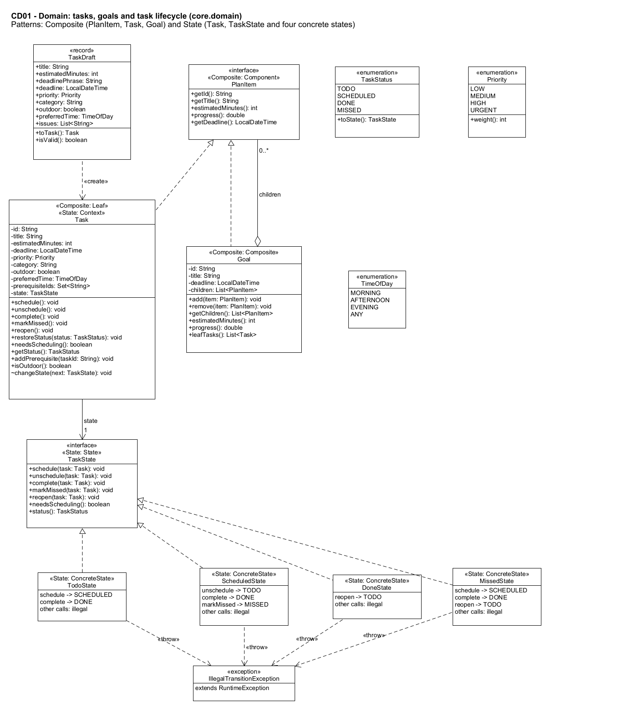
*CD01. Domain: tasks, goals and lifecycle.*

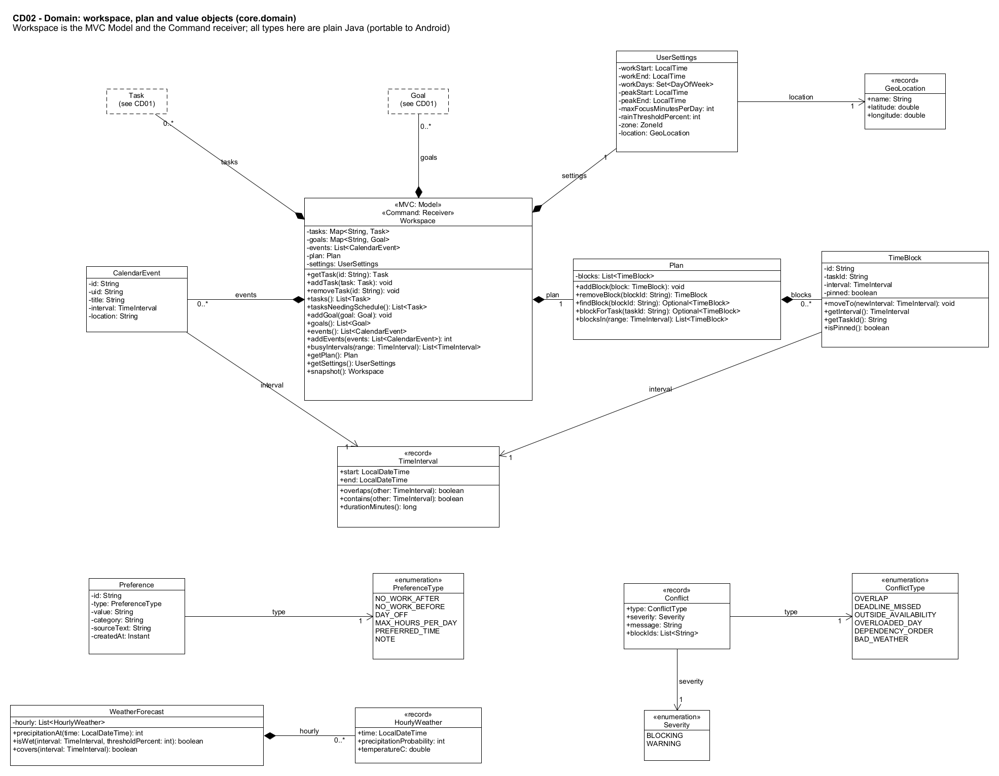
*CD02. Domain: workspace, plan and value objects.*

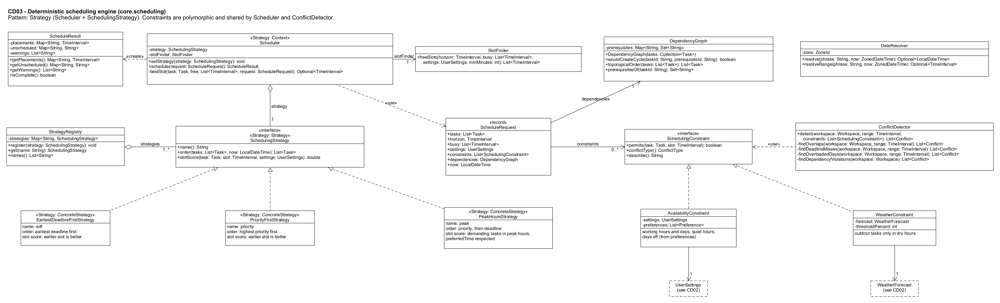
*CD03. Deterministic scheduling engine.*

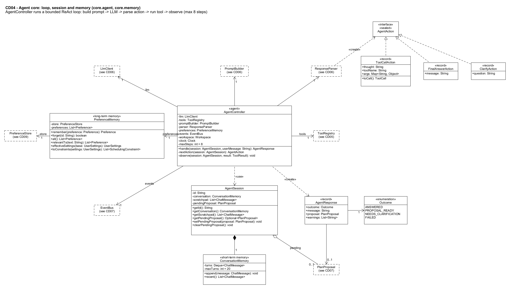
*CD04. Agent core.*

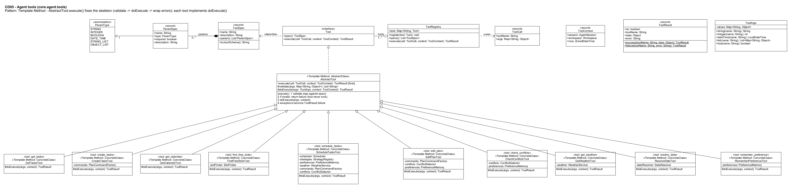
*CD05. Agent tools.*

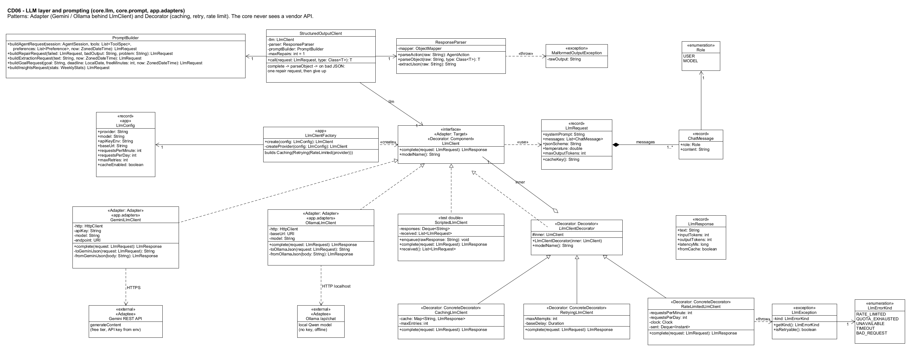
*CD06. LLM layer and prompting.*

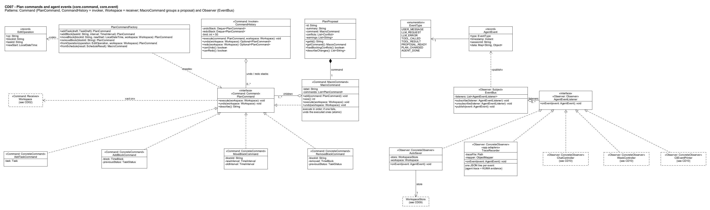
*CD07. Commands and events.*

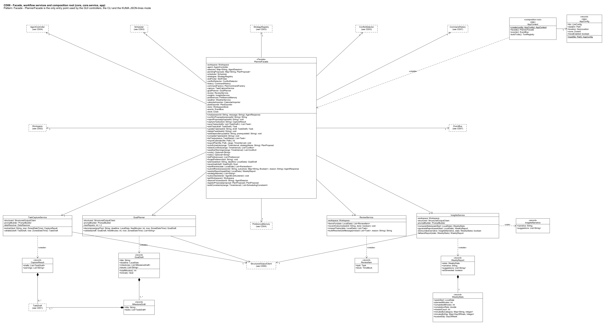
*CD08. Facade, services and composition root.*

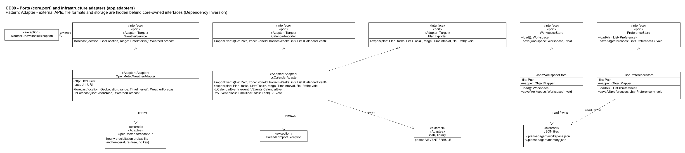
*CD09. Ports and adapters.*

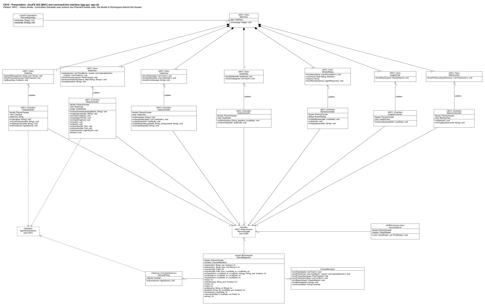
*CD10. GUI (MVC) and CLI.*

### 3.1 Key relationships and multiplicities

| Relationship | Kind | Multiplicity | Meaning |
|---|---|---|---|
| `Workspace` owns `Task`, `Goal`, `CalendarEvent` | composition | 1 to 0..* | The workspace owns the user's data |
| `Workspace` owns `Plan`, `Plan` owns `TimeBlock` | composition | 1 to 1, 1 to 0..* | The plan owns its time blocks |
| `Goal` groups `PlanItem` | aggregation (Composite) | 1 to 0..* children | A goal groups milestones (sub-goals) and tasks |
| `Task` -> `TaskState` | association (State) | 1 | Current lifecycle state |
| `Scheduler` -> `SchedulingStrategy` | aggregation (Strategy) | 1 | Replaceable at run time |
| `ScheduleRequest` -> `SchedulingConstraint` | association | 0..* | Availability, weather, ... |
| `ToolRegistry` holds `Tool` | aggregation | 1 to 1..* | 10 registered tools |
| 10 tool classes extend `AbstractTool` | generalization (Template Method) | n/a | Every tool inherits the fixed `execute()` skeleton |
| `LlmClientDecorator` -> `LlmClient` | aggregation (Decorator) | `inner` 1 | Wraps the next client in the chain |
| `GeminiLlmClient`, `OllamaLlmClient` implement `LlmClient` | realization (Adapter) | n/a | Vendor APIs behind one interface |
| `CommandHistory` holds `PlanCommand` | aggregation (Command) | 0..* | Undo and redo stacks |
| `PlanProposal` owns `MacroCommand` | composition | 1 | A proposal is one atomic command |
| `EventBus` holds `AgentEventListener` | aggregation (Observer) | 0..* | Subscribed observers |
| `AgentSession` owns `ConversationMemory` | composition | 1 | Short-term memory per conversation |
| `PlannerFacade` -> subsystems | association (Facade) | 1 each | Single entry point |
| Controllers -> `PlannerFacade`, View | association (MVC) | 1 | A controller updates its view and calls the model through the facade |

Traditional components are the domain, scheduling engine, commands, events, ports, stores, GUI and CLI. AI and agent components are `AgentController`, `AgentSession`, `ConversationMemory`, `PreferenceMemory`, `PromptBuilder`, `ResponseParser`, `StructuredOutputClient`, `ToolRegistry` and its tools, `LlmClient` and its decorators and adapters, `TaskCaptureService`, `GoalPlanner` and `InsightsService`.

---

## 4. Design patterns

PlannedAgent uses ten patterns (eight GoF patterns plus Composite and MVC). Each one solves a concrete problem in this application.

| # | Pattern | Participating classes | Features |
|---|---|---|---|
| P1 | Strategy | `Scheduler`, `SchedulingStrategy`, 3 strategies, `StrategyRegistry` | F04, F05, F11 |
| P2 | Adapter | `LlmClient` (implemented by `GeminiLlmClient`, `OllamaLlmClient`); `WeatherService` (by `OpenMeteoWeatherAdapter`); `CalendarImporter`/`PlanExporter` (by `IcsCalendarAdapter`) | F01, F03, F04, F08-F12 |
| P3 | Decorator | `LlmClient`, `LlmClientDecorator`, `CachingLlmClient`, `RetryingLlmClient`, `RateLimitedLlmClient` | every AI feature |
| P4 | Command | `PlanCommand`, `Add/Move/RemoveBlockCommand`, `AddTaskCommand`, `MacroCommand`, `CommandHistory`, `Workspace` | F04-F07, F11 |
| P5 | Observer | `EventBus`, `AgentEventListener`, `ChatController`, `WeekController`, `CliEventPrinter`, `TraceRecorder`, `AutoSaver` | F02-F07, F11 |
| P6 | Facade | `PlannerFacade` (clients: GUI controllers, `PlannedAgentCli`, `JsonLineServer`) | all |
| P7 | Template Method | `AbstractTool` and its 10 tool subclasses | F04, F06, F07, F09, F11 |
| P8 | State | `Task`, `TaskState`, `TodoState`, `ScheduledState`, `DoneState`, `MissedState` | F02, F05, F11 |
| P9 | Composite | `PlanItem`, `Task` (leaf), `Goal` (composite) | F10 |
| P10 | MVC | `Workspace` / `PlannerFacade` (model), `*View` (view), `*Controller` (controller) | GUI for all |

### P1: Strategy (scheduling algorithms)

* **Problem.** Users plan differently: some prefer deadline-first, some priority-first, and some want demanding work in their peak-energy hours. The agent also needs to pick an approach by name. Hard-coding these options as `if/else` inside `Scheduler` would mix several algorithms into one class and change it every time a strategy is added.
* **Participants and roles.**
  * `Scheduler` is the Context: it holds a `SchedulingStrategy` and calls `order()` and `slotScore()`.
  * `SchedulingStrategy` is the Strategy interface.
  * `EarliestDeadlineFirstStrategy`, `PriorityFirstStrategy` and `PeakHoursStrategy` are the Concrete Strategies.
  * `StrategyRegistry` looks strategies up by name for the GUI drop-down, the CLI flag and the `schedule_tasks` tool.
* **Why appropriate.** These are interchangeable algorithms that share one shape (order the tasks, score a slot) and are chosen at run time.
* **Without it.** Every new strategy would mean editing and re-testing `Scheduler`, which breaks Open/Closed. The strategies also could not be unit-tested in isolation.

### P2: Adapter (LLM providers, weather API, iCalendar)

* **Problem.** External systems have incompatible interfaces: Gemini's `generateContent` JSON, Ollama's `/api/chat`, Open-Meteo's hourly arrays, and ical4j's `VEVENT` objects. The user also wants to switch between Gemini and a local Qwen model.
* **Participants and roles.**
  * Targets (core interfaces): `LlmClient`, `WeatherService`, `CalendarImporter`, `PlanExporter`.
  * Adapters: `GeminiLlmClient`, `OllamaLlmClient`, `OpenMeteoWeatherAdapter`, `IcsCalendarAdapter`.
  * Adaptees: the vendor APIs and libraries.
  * Clients: `AgentController`, `StructuredOutputClient`, `PlannerFacade`, `ScheduleTasksTool`, `GetWeatherTool`.
* **Why appropriate.** The core speaks only in its own terms (`LlmRequest`/`LlmResponse`, `WeatherForecast`, `CalendarEvent`). Changing the model, weather provider or file format means adding one class.
* **Without it.** Vendor JSON would leak into the agent and scheduler. Switching from Gemini to Qwen would touch many classes. The core could not be tested offline or reused on Android.

### P3: Decorator (cross-cutting LLM policies)

* **Problem.** Free-tier LLMs need caching to save quota, rate limiting (requests per minute and per day), and retries with back-off on 429/503 errors. These policies apply to every provider and every caller. Putting them in each adapter would duplicate code, and subclassing every combination would explode the number of classes.
* **Participants and roles.**
  * Component: `LlmClient`.
  * Concrete components: `GeminiLlmClient`, `OllamaLlmClient`, `ScriptedLlmClient`.
  * Decorator: the abstract `LlmClientDecorator`, which holds `inner: LlmClient`.
  * Concrete Decorators: `CachingLlmClient`, `RetryingLlmClient`, `RateLimitedLlmClient`.
  * `LlmClientFactory` assembles the chain `Caching(Retrying(RateLimited(provider)))` (SD13).
* **Why appropriate.** Each policy is added transparently behind the same interface, and the policies can be combined or removed from configuration (for example, caching is turned off for KUMA runs).
* **Without it.** The retry, quota and cache logic would be copied into every provider or every caller, and could not be tested on its own (with a fake clock).

### P4: Command (plan changes, confirmation and undo/redo)

* **Problem.** The LLM must not change the plan directly. A change has to be described first, checked on a copy, shown to the user, applied only when confirmed, and undone if the user changes their mind. This holds whether the change comes from the agent, Auto-schedule or an end-of-day review.
* **Participants and roles.**
  * Command: `PlanCommand` (`execute`, `undo`, `describe`).
  * Concrete Commands: `AddTaskCommand`, `AddBlockCommand`, `MoveBlockCommand`, `RemoveBlockCommand`.
  * MacroCommand: groups the commands of one proposal and executes them atomically; it is also a Composite of commands.
  * Invoker: `CommandHistory`, with the undo/redo stacks.
  * Receiver: `Workspace`.
  * Clients: `PlanCommandFactory` creates the commands; `PlanProposal` holds the macro until it is confirmed.
* **Why appropriate.** A change becomes a value that can be previewed, validated on a `snapshot()`, stored, applied and reversed.
* **Without it.** There would be no safe preview and no reliable undo. AI mistakes would go straight into user data, and rolling back a half-applied multi-step change would need special-case code.

### P5: Observer (agent and plan events)

* **Problem.** When the agent calls a tool or the plan changes, several independent parts must react:
  * the chat shows live status
  * the week view refreshes
  * the CLI prints progress
  * the workspace is auto-saved
  * a JSON trace is written for evaluation

  The agent and the facade should not know about any of them.
* **Participants and roles.**
  * Subject: `EventBus` (`subscribe`, `unsubscribe`, `publish`).
  * Observer: `AgentEventListener`.
  * Concrete Observers: `ChatController`, `WeekController`, `CliEventPrinter`, `TraceRecorder`, `AutoSaver`.
  * Event: `AgentEvent` with an `EventType`.
* **Why appropriate.** One-to-many notification with loose coupling; new listeners such as a notification service need no change to the publishers.
* **Without it.** `AgentController` and `PlannerFacade` would have to call the GUI, CLI, persistence and tracing directly. The core would then depend on JavaFX and the file system, which breaks layering and portability.

### P6: Facade (one entry point for GUI, CLI and test harness)

* **Problem.** A feature such as Auto-schedule coordinates about eight subsystems: `StrategyRegistry`, `Scheduler`, `PreferenceMemory`, `WeatherService`, `PlanCommandFactory`, `Workspace`, `ConflictDetector` and `CommandHistory`. Three front-ends need the same features: the GUI, the CLI and the JSON-lines mode used by KUMA.
* **Participants and roles.**
  * Facade: `PlannerFacade`.
  * Subsystems: the agent, the scheduling engine, commands, services, memory, ports and events.
  * Clients: the seven GUI controllers, `PlannedAgentCli` and `JsonLineServer`.
* **Why appropriate.** It gives a simple, stable API (`chat`, `autoSchedule`, `confirmProposal`, `undo`, ...), guarantees that the GUI and CLI behave the same, and gives the KUMA harness one clean seam to call.
* **Without it.** Each front-end would repeat the orchestration logic, and the GUI and CLI would slowly drift apart. Tests would need to wire up dozens of objects.

### P7: Template Method (safe, uniform tool execution)

* **Problem.** The LLM may call any of the 10 tools with wrong, missing or invented arguments. Every tool must follow the same safety steps:
  1. validate the arguments against its `ToolSpec`
  2. skip execution if the arguments are invalid
  3. turn exceptions into an error observation the agent can recover from
  4. publish trace events

  Copying these steps into 10 tools is error-prone.
* **Participants and roles.**
  * AbstractClass: `AbstractTool`, whose `execute()` is `final`: `validate` -> `doExecute` -> wrap the result or error.
  * Concrete Classes: the 10 tools, each implementing only `doExecute()` (and `spec()`).
  * Supporting types: `ToolRegistry`, `ToolSpec`, `ToolArgs`, `ToolResult`.
* **Why appropriate.** The steps are the same for every tool and only the actual work differs, so Template Method fits.
* **Without it.** One tool that forgot validation could execute invalid LLM output. Behaviour such as "invalid input is never executed" (a key Stage 3 behavioural requirement) could not be guaranteed by construction.

### P8: State (task lifecycle)

* **Problem.** A task behaves differently depending on its status:
  * a DONE task cannot be scheduled
  * a MISSED task needs rescheduling
  * a TODO task cannot be "missed"
  * a SCHEDULED task can be unscheduled

  Without the pattern, these rules would be `switch(status)` blocks spread across the scheduler, the review service, the commands and the UI.
* **Participants and roles.**
  * Context: `Task` (`schedule`, `unschedule`, `complete`, `markMissed`, `reopen`, `needsScheduling`).
  * State: `TaskState`.
  * Concrete States: `TodoState`, `ScheduledState`, `DoneState`, `MissedState`. Illegal transitions throw `IllegalTransitionException`.
* **Why appropriate.** The transition rules live in one small class per state, and `needsScheduling()` lets the scheduler ask a question without checking the status itself.
* **Without it.** The lifecycle rules would be duplicated and inconsistent, and an invalid transition (for example rescheduling a finished task) would be easy to miss.

### P9: Composite (goals, milestones and tasks)

* **Problem.** Goal decomposition (F10) produces a tree: a goal contains milestones, which contain tasks. The UI and the services must compute the total estimate, the progress and the deadline uniformly for a single task and for a whole goal tree.
* **Participants and roles.**
  * Component: `PlanItem`.
  * Leaf: `Task`.
  * Composite: `Goal`, whose `children` are `PlanItem`s; `estimatedMinutes()` and `progress()` work recursively, and `leafTasks()` flattens the tree for the scheduler.
* **Why appropriate.** It is a part-whole hierarchy where clients should treat parts and wholes the same way.
* **Without it.** Every caller would need to tell goals and tasks apart and walk the tree by hand, and nested milestones would need a separate type.

### P10: MVC (GUI architecture)

* **Problem.** The GUI has seven screens that display and change the same data. UI code must not contain planning logic, so that the same logic serves the CLI and the tests.
* **Participants and roles.**
  * Model: `Workspace` and the domain classes, reached through `PlannerFacade`.
  * Views: `MainView`, `ChatView`, `WeekView`, `TasksView`, `GoalsView`, `ReviewDialog`, `InsightsView`, `MemoryView`.
  * Controllers: `ChatController`, `WeekController`, `TasksController`, `GoalsController`, `ReviewController`, `InsightsController`, `MemoryController`.

  Controllers turn UI actions into facade calls and update their views. Model changes reach the controllers through the Observer (P5).
* **Why appropriate.** It is the standard separation for an event-driven desktop UI, and it lets the CLI reuse the model unchanged.
* **Without it.** Planning logic would end up inside JavaFX event handlers, could not be tested without a GUI, and would have to be duplicated for the CLI.

Supporting idioms (not counted above): Ports and Adapters / Dependency Inversion (`core.port`), Repository-style stores (`WorkspaceStore`, `PreferenceStore`), Registry (`ToolRegistry`, `StrategyRegistry`), Factory (`PlanCommandFactory`, `LlmClientFactory`), and a composition root (`AppContext`).

---

## 5. Use-case diagram

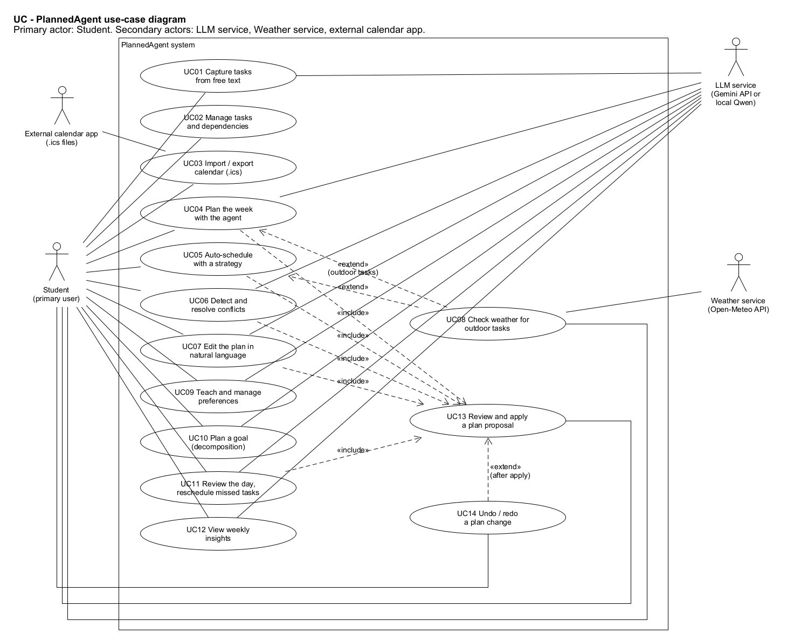
*Figure 2. Use-case diagram (source: [`UC-use-case-diagram.uxf`](diagrams/uxf/UC-use-case-diagram.uxf)).*

**Actors.**

* Student (primary). Uses every use case.
* LLM service (secondary, AI service). Gemini API or local Qwen; takes part in UC01, UC04, UC06, UC07, UC09, UC10, UC11 and UC12.
* Weather service (secondary, external API). Open-Meteo; takes part in UC08.
* External calendar app (secondary, external system). Source and target of `.ics` files in UC03.

**Relationships.**

* UC04, UC05, UC06, UC07 and UC11 `<<include>>` UC13 *Review and apply a plan proposal*, the shared confirmation step.
* UC08 `<<extend>>`s UC04 and UC05 when outdoor tasks are present.
* UC14 *Undo/redo* `<<extend>>`s UC13 after a proposal has been applied.

Together, the 14 use cases cover all 12 features (see §8).

---

## 6. Use-case descriptions

### UC01: Capture tasks from free text
* **Actors:** Student (primary), LLM service.
* **Goal:** Turn a free-text brain dump into reviewed, saved tasks.
* **Preconditions:** PlannedAgent is running; settings (time zone, defaults) are loaded.
* **Trigger:** The Student types text in *Quick capture* and clicks Extract (or runs `plannedagent capture`).
* **Main success scenario:**
  1. The Student enters free text.
  2. The system sends a schema-constrained extraction request to the LLM.
  3. The system parses the JSON into task drafts.
  4. The system resolves deadline phrases deterministically and validates each draft (estimate range, title, deadline not in the past).
  5. The system shows the drafts, with problem rows highlighted.
  6. The Student edits or removes rows and clicks Save tasks.
  7. The system saves the tasks (state TODO) and shows them in the task list.
* **Alternative/exception flows:**
  * 2a. LLM unavailable or quota exhausted: the system shows "AI unavailable, add tasks manually" and opens the manual form (UC02).
  * 3a. Malformed JSON: the system sends one repair request; if that fails, it reports the error.
  * 4a. Unresolvable date: the draft is flagged "deadline unclear" for the Student to fix.
  * 1a. Empty text: the request is rejected before any LLM call.
* **Postconditions:** The new tasks are stored in the workspace and persisted.
* **Related features:** F01.

### UC02: Manage tasks and dependencies
* **Actors:** Student.
* **Goal:** Keep the task list accurate, including prerequisites and status.
* **Preconditions:** Tasks exist (or are being created).
* **Trigger:** The Student uses the Tasks tab actions or `plannedagent tasks ...`.
* **Main success scenario:**
  1. The Student creates or edits a task.
  2. The Student declares that task A depends on task B.
  3. The system checks the dependency graph for cycles.
  4. The system records the prerequisite.
  5. The Student completes a task.
  6. The system applies the State transition to DONE.
  7. The system saves and refreshes all views.
* **Alternative/exception flows:**
  * 3a. A cycle would be created: rejected, with the cycle path shown.
  * 6a. Illegal transition (e.g. completing a DONE task): rejected with a message.
  * 1a. Invalid fields: validation message.
  * Delete a task with dependants: the system asks for confirmation and removes the links.
* **Postconditions:** The task graph is acyclic, and statuses are consistent with the lifecycle rules.
* **Related features:** F02.

### UC03: Import / export calendar (.ics)
* **Actors:** Student (primary), External calendar app.
* **Goal:** Bring fixed commitments in, or send the plan out.
* **Preconditions:** An `.ics` file is available (import), or a plan exists (export).
* **Trigger:** Import .ics / Export .ics, or `plannedagent import|export`.
* **Main success scenario:**
  1. The Student selects a file.
  2. The system parses the events and expands weekly recurrences over 16 weeks.
  3. The system adds the events, skipping duplicates by UID.
  4. The system saves and shows the count.
  5. (Export) The Student picks a date range and a file.
  6. The system writes one VEVENT per block.
* **Alternative/exception flows:**
  * 2a. Invalid or unreadable file: `CalendarImportException`; nothing is imported.
  * 2b. Event without an end time: 1 h default plus a warning.
  * 6a. Unwritable path: error message.
* **Postconditions:** Fixed events are part of the busy time used for planning, or an `.ics` file has been written.
* **Related features:** F03.

### UC04: Plan the week with the agent
* **Actors:** Student (primary), LLM service; Weather service (via the UC08 extension).
* **Goal:** Get a conflict-free, time-blocked plan from a natural-language request.
* **Preconditions:** Tasks exist; an LLM provider is configured.
* **Trigger:** The Student sends a planning request in the chat (or `plannedagent ask`).
* **Main success scenario:**
  1. The Student sends the request.
  2. The agent retrieves the relevant preferences.
  3. The agent loops: it asks the LLM for the next action and runs the chosen tool (`get_tasks`, `get_calendar`, `schedule_tasks`, `check_conflicts`), observing each result.
  4. The agent gives a final answer that explains the plan and lists unscheduled tasks.
  5. The system shows the proposal.
  6. The Student reviews and applies it (include UC13).
* **Alternative/exception flows:**
  * 3a. A tool fails: an error observation is returned; the agent continues and tells the Student.
  * 3b. Malformed LLM output: one repair attempt, else FAILED with a suggestion to Auto-schedule.
  * 3c. 8-step limit reached: partial answer.
  * 3d. Ambiguous request: the agent asks a clarifying question and the use case resumes at step 1.
  * 3e. Outdoor tasks: extend UC08.
  * 2a. LLM unavailable: the Student is offered UC05.
* **Postconditions:** A proposal exists; after UC13 the plan is updated, persisted and undoable.
* **Related features:** F04 (uses F05, F06, F08, F09).

### UC05: Auto-schedule with a strategy
* **Actors:** Student; Weather service (via UC08).
* **Goal:** Schedule all tasks that need a slot, deterministically, without an LLM.
* **Preconditions:** Tasks that need scheduling exist.
* **Trigger:** Auto-schedule with a chosen strategy (or `plannedagent schedule`).
* **Main success scenario:**
  1. The Student picks a strategy and clicks Auto-schedule.
  2. The system builds the constraints (availability and preferences, plus weather if outdoor tasks exist).
  3. The system computes free slots and orders the tasks with the strategy, prerequisites first.
  4. The system places each task in its best permitted slot.
  5. The system simulates the result and checks for conflicts.
  6. The system shows the proposal and the reasons for any unscheduled task.
  7. The Student applies it (include UC13).
* **Alternative/exception flows:**
  * 1a. Unknown strategy: falls back to EDF with a warning.
  * 2a. Weather API down: continue with a warning.
  * 4a. No slot fits: the task is reported as unscheduled with a reason.
* **Postconditions:** As UC04.
* **Related features:** F05, F08.

### UC06: Detect and resolve conflicts
* **Actors:** Student, LLM service.
* **Goal:** See plan problems and fix them.
* **Preconditions:** A plan exists.
* **Trigger:** Any plan change (automatic), Check conflicts, or `plannedagent conflicts`.
* **Main success scenario:**
  1. The system detects overlaps, deadline misses, overload, availability and dependency violations, and bad weather.
  2. The system shows them with their severity.
  3. The Student clicks *Ask agent to fix*.
  4. The agent proposes edits, re-checked on a snapshot.
  5. The Student applies them (include UC13).
* **Alternative/exception flows:**
  * 1a. No conflicts: "All clear".
  * 4a. The fix still has blocking conflicts: the proposal cannot be applied and the agent explains why.
  * 1b. Weather unknown: the rain check is skipped, with a note.
* **Postconditions:** No blocking conflicts remain in the applied plan.
* **Related features:** F06, F08.

### UC07: Edit the plan in natural language
* **Actors:** Student, LLM service.
* **Goal:** Change the plan conversationally.
* **Preconditions:** A plan with blocks exists.
* **Trigger:** A chat instruction such as "move gym to tomorrow 7 am".
* **Main success scenario:**
  1. The Student gives the instruction.
  2. The agent resolves the dates deterministically (`resolve_date`).
  3. The agent finds the target blocks (`get_calendar`).
  4. The agent proposes edit commands (`edit_plan`), which are validated and conflict-checked.
  5. The system shows the proposal.
  6. The Student applies it (include UC13).
* **Alternative/exception flows:**
  * 4a. Invalid or missing tool arguments: the tool returns a failure without running; the agent corrects the call or asks.
  * 3a. Ambiguous block: clarifying question.
  * 4b. Pinned block: refused.
  * 4c. New conflict: shown in the proposal.
* **Postconditions:** As UC04; the change can be undone (UC14).
* **Related features:** F07.

### UC08: Check weather for outdoor tasks
* **Actors:** Student, Weather service.
* **Goal:** Keep outdoor tasks out of rainy hours.
* **Preconditions:** A location is set; outdoor tasks or blocks exist.
* **Trigger:** Check weather, or automatically during UC04/UC05 (extension point "outdoor tasks").
* **Main success scenario:**
  1. The system requests the hourly forecast.
  2. The system builds the weather constraint.
  3. During scheduling, outdoor tasks are placed only in dry hours.
  4. Existing outdoor blocks in rain are flagged BAD_WEATHER.
* **Alternative/exception flows:**
  * 1a. API failure or timeout: continue without the constraint and warn the Student.
  * 1b. Beyond the forecast horizon: no constraint for those days.
  * No location set: ask the Student to set one.
* **Postconditions:** Outdoor blocks are either in dry hours or flagged.
* **Related features:** F08.

### UC09: Teach and manage preferences
* **Actors:** Student, LLM service.
* **Goal:** Have the agent remember personal rules and apply them.
* **Preconditions:** None.
* **Trigger:** The Student states a rule in the chat, or opens the Memory tab.
* **Main success scenario:**
  1. The Student states a rule ("I never study after 10 pm").
  2. The agent calls `remember_preference` with structured arguments.
  3. The tool validates them.
  4. Memory replaces any older rule with the same type and category, and persists.
  5. The agent confirms.
  6. Future plans use the rule as a constraint.
  7. The Student can list or forget preferences in the Memory tab.
* **Alternative/exception flows:**
  * 3a. Invalid value (e.g. 25:00): the tool fails and the agent asks for clarification.
  * 4a. Storage failure: the agent must not claim the rule was saved.
* **Postconditions:** The preference is stored and active, or removed.
* **Related features:** F09.

### UC10: Plan a goal (decomposition)
* **Actors:** Student, LLM service.
* **Goal:** Turn a goal and deadline into a validated tree of milestones and tasks.
* **Preconditions:** The deadline is in the future.
* **Trigger:** Plan goal (or `plannedagent goal`).
* **Main success scenario:**
  1. The Student enters the goal and deadline.
  2. The system computes the free minutes before the deadline.
  3. The LLM proposes milestones and tasks.
  4. The system validates the draft (fits the free time, valid estimates, no empty milestones).
  5. The system shows the tree.
  6. The Student edits it and saves.
  7. The system stores the Goal (Composite) with ordered prerequisites.
* **Alternative/exception flows:**
  * 1a. Deadline in the past: rejected before any LLM call.
  * 4a. Invalid draft: up to 2 repair rounds; if still invalid, it is shown with its issues for manual editing.
  * 3a. LLM unavailable: message.
* **Postconditions:** The goal and its tasks exist, and goal progress is tracked.
* **Related features:** F10.

### UC11: Review the day and reschedule missed tasks
* **Actors:** Student, LLM service.
* **Goal:** Close the day honestly and recover missed work.
* **Preconditions:** Blocks are scheduled for today.
* **Trigger:** Review today (or `plannedagent review`).
* **Main success scenario:**
  1. The system lists today's blocks.
  2. The Student marks each one Done or Missed and optionally gives a reason.
  3. The system applies the State transitions and removes the missed blocks.
  4. The agent reschedules the missed tasks, taking the reason into account.
  5. The system shows the proposal.
  6. The Student applies it (include UC13).
* **Alternative/exception flows:**
  * 1a. No blocks today: "Nothing to review".
  * 4a. LLM unavailable: deterministic Auto-schedule fallback (EDF).
  * 4b. A missed task is past its deadline: flagged.
  * The Student cancels: nothing changes.
* **Postconditions:** Today's statuses are recorded and the missed tasks have proposed new slots.
* **Related features:** F11.

### UC12: View weekly insights
* **Actors:** Student, LLM service.
* **Goal:** Understand how the week went and get grounded suggestions.
* **Preconditions:** Plan history exists.
* **Trigger:** Generate on the Insights tab (or `plannedagent report`).
* **Main success scenario:**
  1. The Student picks a week.
  2. The system computes the statistics deterministically.
  3. The LLM writes a narrative with three suggestions.
  4. The system checks that the narrative only cites numbers from the statistics.
  5. The system shows the chart, statistics and narrative (and can export Markdown).
* **Alternative/exception flows:**
  * 2a. No data: "No planned tasks this week".
  * 3a. LLM failure or malformed output: template narrative (`aiGenerated = false`).
  * 4a. Ungrounded narrative: template narrative.
* **Postconditions:** A report is displayed or exported.
* **Related features:** F12.

### UC13: Review and apply a plan proposal (included use case)
* **Actors:** Student.
* **Goal:** Accept or discard a proposed set of plan changes safely.
* **Preconditions:** A proposal was produced by UC04, UC05, UC06, UC07 or UC11.
* **Trigger:** Apply or Discard on a proposal card (CLI: yes/no).
* **Main success scenario:**
  1. The Student reviews the listed changes and conflicts.
  2. The Student clicks Apply.
  3. The system checks that the proposal is still valid and has no blocking conflicts.
  4. The invoker executes the macro command atomically, and tasks move to SCHEDULED.
  5. The system publishes PLAN_CHANGED.
  6. The views refresh, the workspace auto-saves and the trace is recorded.
* **Alternative/exception flows:**
  * 2a. Discard: the proposal is dropped and nothing changes.
  * 3a. Unknown or stale proposal: "no longer valid".
  * 3b. Blocking conflicts: Apply is refused.
  * 4a. A command fails mid-way: the commands already executed are undone and the workspace is unchanged.
* **Postconditions:** Either nothing changed, or all changes were applied and recorded for undo.
* **Related features:** F04, F05, F06, F07, F11.

### UC14: Undo / redo a plan change
* **Actors:** Student.
* **Goal:** Reverse or re-apply the last plan change.
* **Preconditions:** At least one change has been applied (undo) or undone (redo).
* **Trigger:** Undo / Redo or Ctrl+Z / Ctrl+Y (CLI `plannedagent undo|redo`).
* **Main success scenario:**
  1. The Student presses Undo.
  2. The invoker pops the last command and undoes its sub-commands in reverse order.
  3. The command moves to the redo stack.
  4. The system publishes PLAN_CHANGED, and the views refresh.
* **Alternative/exception flows:**
  * 2a. Nothing to undo: "Nothing to undo".
  * After a new change, the redo stack is cleared.
* **Postconditions:** The plan is restored to its previous state.
* **Related features:** F07.

---

## 7. Sequence diagrams

The 14 sequence diagrams cover every feature and every use case. Each one shows:

* the initiating actor
* the boundary objects (GUI views and controllers, or the CLI)
* the facade, domain and agent objects
* the LLM and external services
* the method calls, return values, and alternative or error flows (`alt`, `opt`, `loop`, `ref`)

All messages use classes and methods exactly as they appear in the class diagrams. UMLet sources are in [`diagrams/uxf/`](diagrams/uxf/).

| SD | Title | Features / use cases | Patterns shown |
|---|---|---|---|
| SD01 | Capture tasks from free text | F01 / UC01 | Facade, MVC, Decorator (via `LlmClient`) |
| SD02 | Add a dependency and complete a task | F02 / UC02 | State, Observer |
| SD03 | Import / export a calendar (CLI) | F03 / UC03 | Adapter, Facade, Observer |
| SD04 | The agent plans the week (ReAct loop) | F04 / UC04 | Facade, Template Method, Observer |
| SD05 | Auto-schedule with strategy and weather | F05, F08 / UC05, UC08 | Strategy, Adapter, Command |
| SD06 | Detect conflicts and let the agent fix them | F06 / UC06 | Observer, Template Method |
| SD07 | Edit the plan in natural language | F07 / UC07 | Template Method, Command |
| SD08 | Review and apply a plan proposal | UC13 (F04-F07, F11) | Command, State, Observer |
| SD09 | Learn a preference and use it later | F09 / UC09 | Template Method |
| SD10 | Plan a goal with validation and repair | F10 / UC10 | Composite, Facade |
| SD11 | End-of-day review and rescheduling | F11 / UC11 | State, Strategy (fallback) |
| SD12 | Weekly insights report (CLI) | F12 / UC12 | Facade |
| SD13 | One LLM call through the decorator chain | all AI features | Decorator, Adapter |
| SD14 | Undo and redo a plan change | F07 / UC14 | Command, Observer |

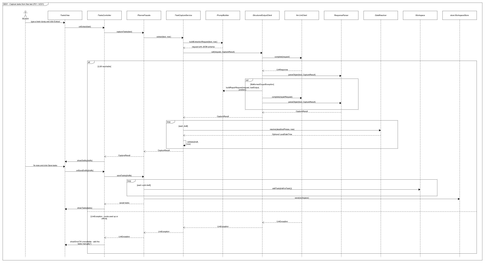
*SD01. Capture tasks. Alternatives: malformed JSON (one repair) and LLM unavailable (manual entry).*

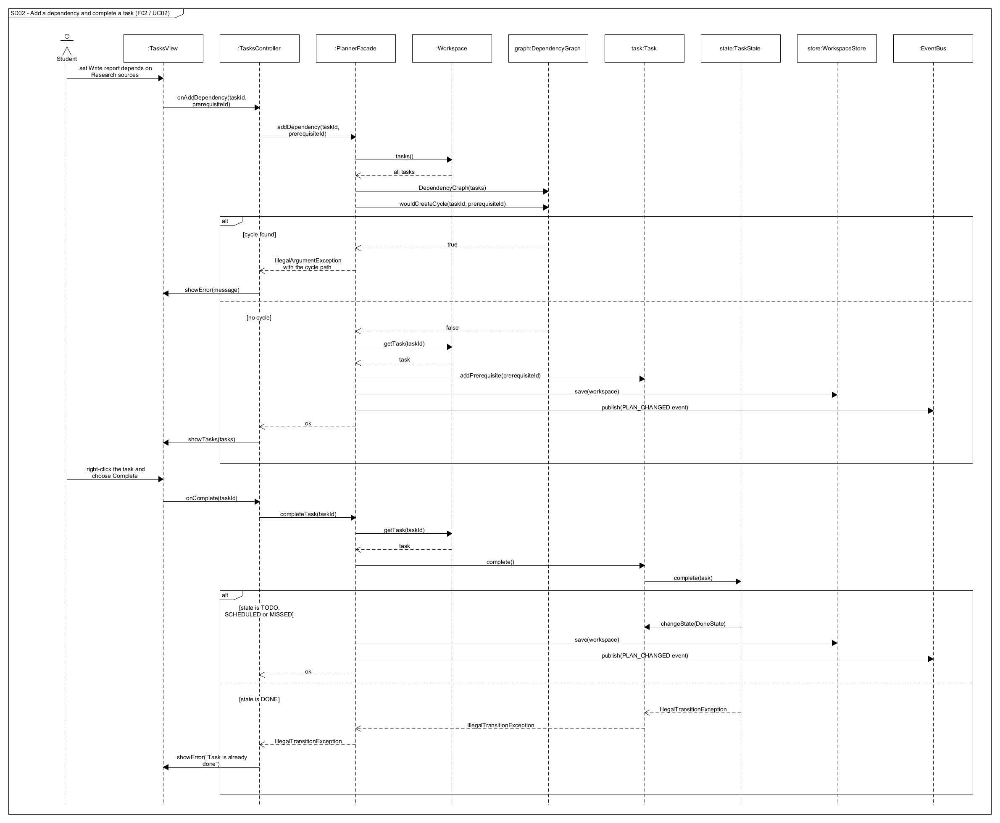
*SD02. Dependency cycle check and the State transition to DONE; illegal transitions are rejected.*

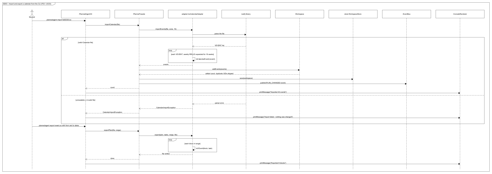
*SD03. CLI import (all-or-nothing) and export through the iCalendar adapter.*

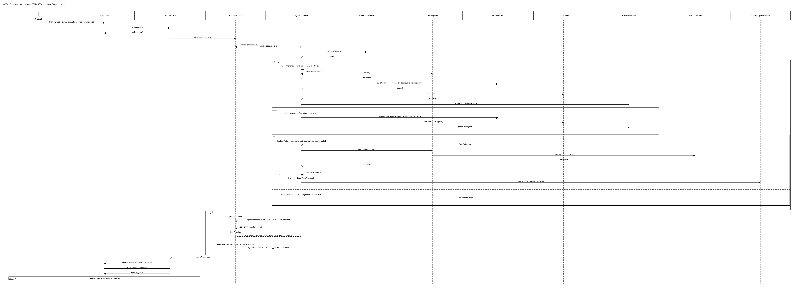
*SD04. The bounded ReAct loop: prompt -> LLM -> parse -> tool -> observe; outcomes are proposal, clarification or failure.*

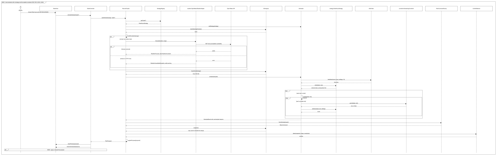
*SD05. Strategy selection, the weather constraint (with failure path), slot scoring, simulation on a snapshot, and conflict check.*

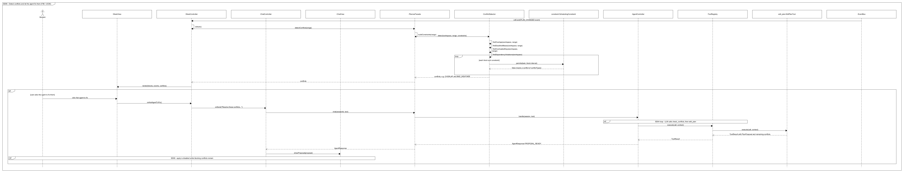
*SD06. Automatic conflict detection after PLAN_CHANGED and the agent-proposed fix.*

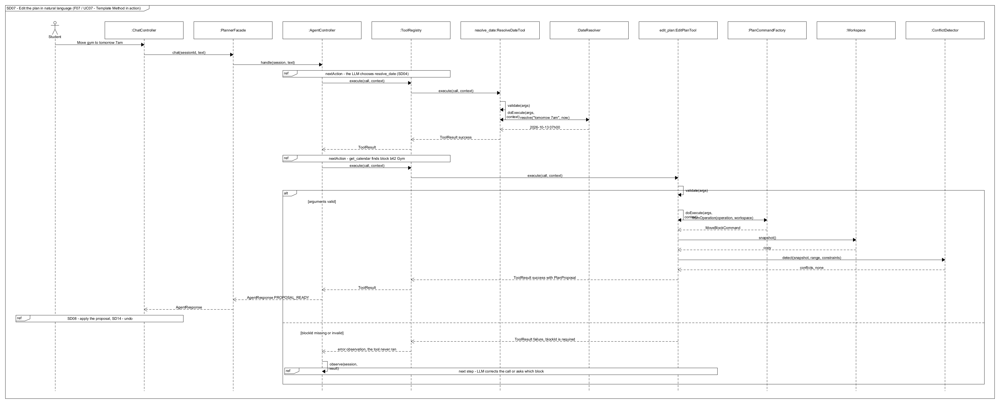
*SD07. `validate -> doExecute` inside each tool. Invalid arguments are rejected before the tool runs.*

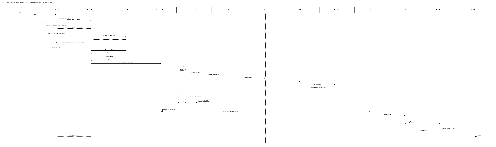
*SD08. Atomic MacroCommand execution, the TODO -> SCHEDULED transition, and observers (auto-save, trace, view refresh).*

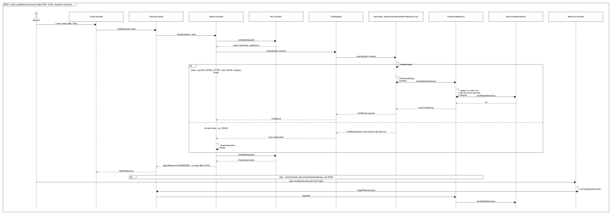
*SD09. Long-term memory: remember, persist, forget; later turned into scheduling constraints.*

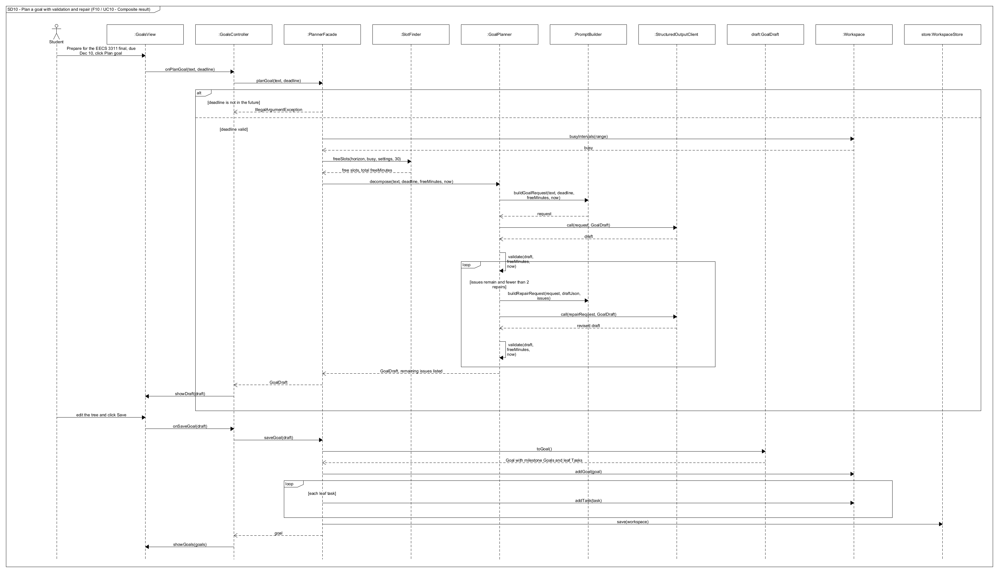
*SD10. Goal decomposition with deterministic validation and up to two repair rounds; the result is a Composite goal tree.*

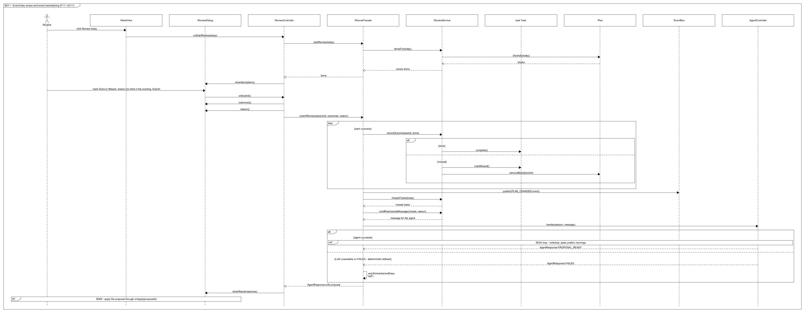
*SD11. Done/Missed transitions, agent rescheduling, and the deterministic fallback.*

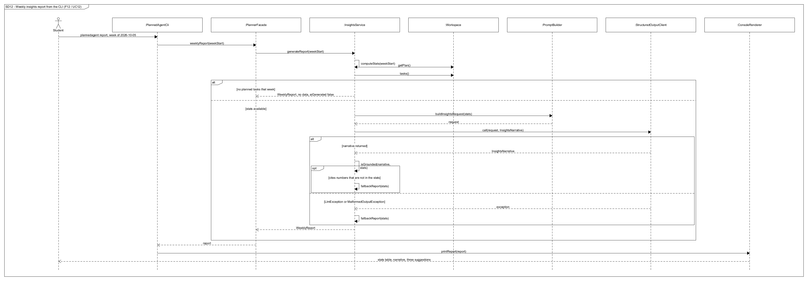
*SD12. Deterministic statistics, AI narrative, grounding check and template fallback (CLI path).*

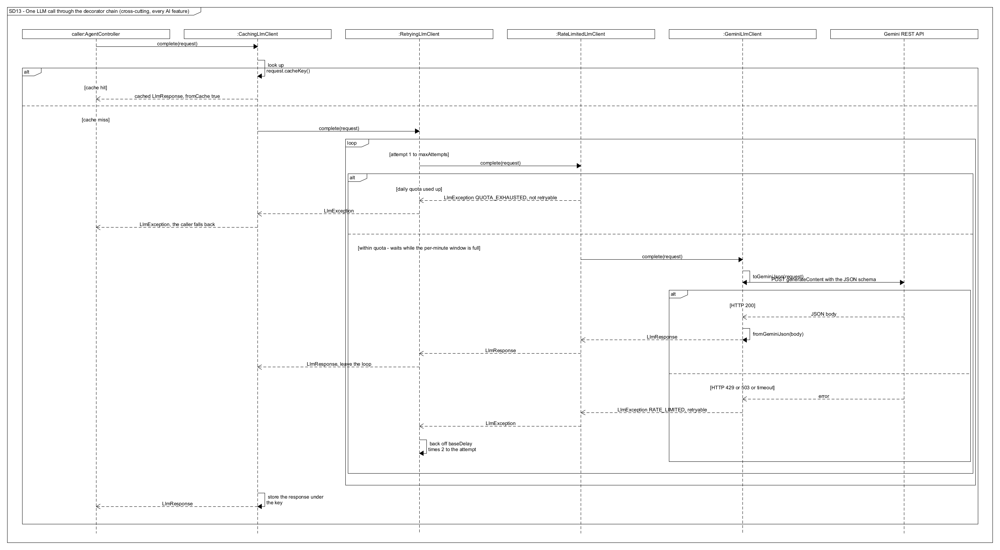
*SD13. Cache -> retry -> rate limit -> Gemini adapter, with quota and HTTP 429/503 handling.*

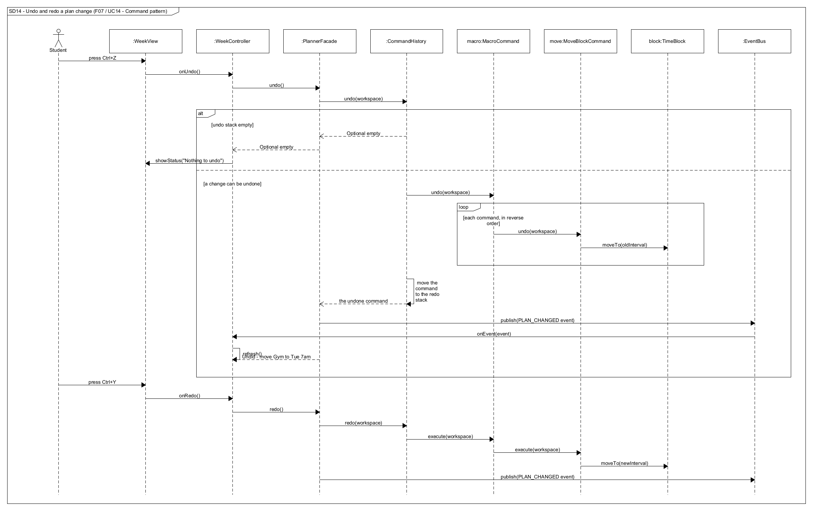
*SD14. Undo and redo through CommandHistory and MacroCommand.*

---

## 8. Feature-to-design traceability table

| Feature | Description | Type | Related use case | Classes | Key methods | Sequence diagram | Design pattern(s) |
|---|---|---|---|---|---|---|---|
| F01 | Capture tasks from free text | Hybrid | UC01 | TasksView, TasksController, PlannerFacade, TaskCaptureService, PromptBuilder, StructuredOutputClient, LlmClient, ResponseParser, DateResolver, Workspace, WorkspaceStore | `captureTasks()`, `extract()`, `buildExtractionRequest()`, `call()`, `complete()`, `parseObject()`, `resolve()`, `saveTasks()`, `addTask()` | SD01, SD13 | Facade, MVC, Decorator, Adapter |
| F02 | Tasks, dependencies, lifecycle | Deterministic | UC02 | TasksController, PlannerFacade, DependencyGraph, Task, TaskState (+4 states), Workspace, EventBus | `addDependency()`, `wouldCreateCycle()`, `addPrerequisite()`, `completeTask()`, `complete()`, `changeState()`, `publish()` | SD02 | State, Observer, Facade |
| F03 | Calendar import/export | Deterministic | UC03 | PlannedAgentCli, WeekController, PlannerFacade, CalendarImporter, PlanExporter, IcsCalendarAdapter, Workspace | `importCalendar()`, `importEvents()`, `toCalendarEvent()`, `addEvents()`, `exportPlan()`, `export()`, `toVEvent()` | SD03 | Adapter, Facade |
| F04 | Agent plans the week | Hybrid (AI-led) | UC04, UC13 | ChatView, ChatController, PlannerFacade, AgentController, AgentSession, PreferenceMemory, PromptBuilder, LlmClient, ResponseParser, ToolRegistry, AbstractTool + tools, Scheduler, ConflictDetector, PlanProposal | `chat()`, `handle()`, `nextAction()`, `buildAgentRequest()`, `complete()`, `parseAction()`, `execute()`, `doExecute()`, `observe()`, `registerProposal()` | SD04, SD08, SD13 | Facade, Template Method, Strategy, Command, Observer, Decorator, MVC |
| F05 | Auto-schedule with strategy | Deterministic | UC05, UC13 | WeekController, PlannerFacade, StrategyRegistry, Scheduler, SchedulingStrategy (+3), SlotFinder, SchedulingConstraint, PlanCommandFactory, MacroCommand, ConflictDetector | `autoSchedule()`, `get()`, `setStrategy()`, `schedule()`, `freeSlots()`, `order()`, `permits()`, `slotScore()`, `fromSchedule()`, `detect()` | SD05, SD08 | Strategy, Command, Facade |
| F06 | Conflict detection and fixes | Hybrid | UC06, UC13 | WeekController, ChatController, PlannerFacade, ConflictDetector, SchedulingConstraint, AgentController, ToolRegistry, CheckConflictsTool, EditPlanTool | `onEvent()`, `refresh()`, `detectConflicts()`, `detect()`, `permits()`, `onAskAgentToFix()`, `handle()` | SD06, SD08 | Observer, Template Method, Command |
| F07 | Natural-language editing with undo/redo | Hybrid | UC07, UC13, UC14 | ChatController, AgentController, ResolveDateTool, DateResolver, EditPlanTool, PlanCommandFactory, MoveBlockCommand, MacroCommand, CommandHistory, WeekController | `handle()`, `validate()`, `doExecute()`, `resolve()`, `fromOperation()`, `execute()`, `undo()`, `redo()`, `moveTo()` | SD07, SD08, SD14 | Command, Template Method, Observer |
| F08 | Weather-aware scheduling | Hybrid (external API) | UC08 | PlannerFacade, WeatherService, OpenMeteoWeatherAdapter, WeatherForecast, WeatherConstraint, ConflictDetector, GetWeatherTool | `buildConstraints()`, `weatherWarnings()`, `forecast()`, `isWet()`, `permits()`, `detect()` | SD05, SD06 | Adapter, Strategy (constraint use), Facade |
| F09 | Preference memory | Hybrid | UC09 | ChatController, AgentController, RememberPreferenceTool, PreferenceMemory, PreferenceStore, JsonPreferenceStore, AvailabilityConstraint, MemoryController | `handle()`, `validate()`, `doExecute()`, `remember()`, `saveAll()`, `relevantTo()`, `toConstraints()`, `forget()` | SD09 | Template Method, Adapter, Facade |
| F10 | Goal decomposition | AI-based (validated) | UC10 | GoalsView, GoalsController, PlannerFacade, SlotFinder, GoalPlanner, PromptBuilder, StructuredOutputClient, GoalDraft, Goal, Task, Workspace | `planGoal()`, `freeSlots()`, `decompose()`, `buildGoalRequest()`, `call()`, `validate()`, `buildRepairRequest()`, `toGoal()`, `addGoal()`, `progress()` | SD10 | Composite, Facade, MVC |
| F11 | End-of-day review and rescheduling | Hybrid | UC11, UC13 | ReviewDialog, ReviewController, PlannerFacade, ReviewService, Task, TaskState, Plan, AgentController, Scheduler | `startReview()`, `itemsFor()`, `submitReview()`, `recordOutcome()`, `complete()`, `markMissed()`, `buildRescheduleMessage()`, `handle()`, `autoSchedule()` | SD11, SD08 | State, Command, Strategy, Facade |
| F12 | Weekly insights report | Hybrid | UC12 | InsightsView, InsightsController, PlannedAgentCli, PlannerFacade, InsightsService, PromptBuilder, StructuredOutputClient, ConsoleRenderer | `weeklyReport()`, `generateReport()`, `computeStats()`, `buildInsightsRequest()`, `call()`, `isGrounded()`, `fallbackReport()`, `printReport()` | SD12 | Facade, Decorator, MVC |

---

## 9. How each feature is realized

### F01: Capture tasks from free text
**Related:** UC01, SD01.

**Classes involved.**
* `TasksView` collects the text and shows the drafts.
* `TasksController` turns clicks into facade calls.
* `PlannerFacade` is the entry point.
* `TaskCaptureService` runs the extraction workflow.
* `PromptBuilder` builds the schema-constrained request.
* `StructuredOutputClient` calls the LLM, parses the output and repairs it once if needed.
* `ResponseParser` converts the JSON into a `CaptureResult`.
* `DateResolver` turns phrases into exact date-times.
* `Workspace` and `WorkspaceStore` store and persist the tasks.

**Important methods.** `TasksController.onExtract()`, `PlannerFacade.captureTasks()`, `TaskCaptureService.extract()`, `PromptBuilder.buildExtractionRequest()`, `StructuredOutputClient.call()`, `DateResolver.resolve()`, `PlannerFacade.saveTasks()`.

**Execution.**
1. Extract calls `onExtract(text)`, which calls `captureTasks(text)`.
2. The service builds a request whose JSON schema lists the task fields, and `call()` sends it through the decorated `LlmClient`.
3. The parsed drafts get exact deadlines from `DateResolver`, then `validate()` adds defaults and flags problems.
4. The view shows the drafts.
5. On save, each valid draft becomes a `Task` (state TODO) via `toTask()`, `Workspace.addTask()` stores it, and the workspace is saved.

### F02: Task management with dependencies and lifecycle
**Related:** UC02, SD02.

**Classes involved.**
* `TasksController` and `PlannerFacade` handle the request.
* `DependencyGraph` detects cycles and gives the topological order.
* `Task` is the State context.
* `TaskState` and its four concrete states hold the transition rules.
* `Workspace` and `EventBus` store the change and notify the views.

**Important methods.** `addDependency()`, `DependencyGraph.wouldCreateCycle()`, `Task.addPrerequisite()`, `completeTask()`, `Task.complete()` -> `TaskState.complete(task)` -> `Task.changeState()`.

**Execution.**
* Adding a dependency. The facade builds a `DependencyGraph` from all tasks. If adding the edge would close a cycle, it returns an error showing the path. Otherwise it records the prerequisite, saves, and publishes `PLAN_CHANGED`.
* Completing a task. `Task.complete()` delegates to the current state object. `TodoState`, `ScheduledState` and `MissedState` switch the task to `DoneState`; `DoneState` throws `IllegalTransitionException`, which is shown as a message.

### F03: Calendar import/export
**Related:** UC03, SD03.

**Classes involved.**
* `PlannedAgentCli` / `WeekController` are the entry points.
* `PlannerFacade` coordinates.
* `CalendarImporter` and `PlanExporter` are the ports, both implemented by `IcsCalendarAdapter` (the adapter over ical4j).
* `Workspace` stores the events, skipping duplicate UIDs.
* `ConsoleRenderer` prints the result.

**Important methods.** `importCalendar()`, `importEvents()`, `toCalendarEvent()`, `Workspace.addEvents()`, `exportPlan()`, `export()`, `toVEvent()`.

**Execution.**
* Import. The adapter parses the file and expands weekly recurrences over 16 weeks into `CalendarEvent`s. The facade adds them, saves and publishes `PLAN_CHANGED`. A parse error raises `CalendarImportException` before anything is added.
* Export. The adapter maps each `TimeBlock` in range, plus its `Task`, to a VEVENT and writes the file.

### F04: Agent plans the week
**Related:** UC04, UC13, SD04, SD08, SD13.

**Classes involved.**
* `ChatView` and `ChatController` form the boundary; the controller is also an Observer that shows live status.
* `PlannerFacade` owns the sessions and the pending proposals.
* `AgentController` runs the loop, using `AgentSession` (conversation, scratchpad, pending proposal) and `PreferenceMemory`.
* `PromptBuilder` and `ResponseParser` handle prompts and parsing; `LlmClient` is the decorated provider.
* `ToolRegistry` and the tools act on the world; `ScheduleTasksTool` uses `Scheduler` and `ConflictDetector`.
* `PlanProposal` is the result.

**Important methods.** `ChatController.onSend()`, `PlannerFacade.chat()`, `AgentController.handle()`, `nextAction()`, `PromptBuilder.buildAgentRequest()`, `LlmClient.complete()`, `ResponseParser.parseAction()`, `ToolRegistry.execute()`, `AbstractTool.execute()`, `observe()`, `registerProposal()`.

**Execution.**
1. `handle()` loads the relevant preferences, then repeats `nextAction()` up to 8 times. Each time it builds a prompt with the tool specs, calls the LLM, and parses one JSON action.
2. A `ToolCallAction` is executed through the registry, and the `ToolResult` is appended to the scratchpad as an observation. If the result carries a `PlanProposal`, it becomes the session's pending proposal.
3. A `FinalAnswerAction` ends the loop. The facade registers the proposal and returns an `AgentResponse(PROPOSAL_READY)`.
4. The controller shows the explanation and the proposal card. Applying it follows SD08.

### F05: Auto-schedule with a selectable strategy
**Related:** UC05, UC13, SD05, SD08.

**Classes involved.**
* `WeekController` and `PlannerFacade` handle the request.
* `StrategyRegistry` provides the strategy, and `Scheduler` is the Strategy context.
* `SchedulingStrategy` and its three implementations are the strategies.
* `SlotFinder` finds free time; `SchedulingConstraint`, `AvailabilityConstraint` and `WeatherConstraint` filter slots.
* `PlanCommandFactory` and `MacroCommand` turn the result into a change.
* `ConflictDetector` checks it, and `PlanProposal` holds it.

**Important methods.** `autoSchedule()`, `StrategyRegistry.get()`, `Scheduler.setStrategy()`, `Scheduler.schedule()`, `SlotFinder.freeSlots()`, `strategy.order()`, `constraint.permits()`, `strategy.slotScore()`, `PlanCommandFactory.fromSchedule()`, `Workspace.snapshot()`, `ConflictDetector.detect()`.

**Execution.**
1. The facade installs the chosen strategy and builds the constraints (preferences, and weather if needed).
2. `schedule()` computes free slots, orders the tasks (prerequisites first), and puts each task in the best-scoring slot that every constraint permits. Tasks that cannot be placed get a reason.
3. The placements become a `MacroCommand` of `AddBlockCommand`s. The macro is executed on a snapshot and conflict-checked.
4. The proposal is shown. Nothing changes until the user applies it.

### F06: Conflict and overload detection with agent fixes
**Related:** UC06, UC13, SD06, SD08.

**Classes involved.**
* `EventBus` notifies `WeekController` (an Observer).
* `PlannerFacade` and `ConflictDetector` (four checks plus the constraints) find the problems.
* `WeekView` shows them.
* `ChatController` and `AgentController` handle the fix, using `CheckConflictsTool` and `EditPlanTool`.

**Important methods.** `WeekController.onEvent()`, `refresh()`, `PlannerFacade.detectConflicts()`, `ConflictDetector.detect()`, `findOverlaps()`, `findDeadlineMisses()`, `findOverloadedDays()`, `findDependencyViolations()`, `SchedulingConstraint.permits()`, `onAskAgentToFix()`.

**Execution.**
1. Every `PLAN_CHANGED` event triggers `refresh()`, which calls `detectConflicts()`. The detector runs its four checks and the constraints (availability, weather) on each block.
2. The view renders badges and the Problems panel.
3. *Ask agent to fix* sends the conflict list to the chat. The agent inspects it (`check_conflicts`) and proposes moves (`edit_plan`).
4. Each proposal is re-checked on a snapshot. A proposal with blocking conflicts cannot be applied.

### F07: Natural-language editing with undo/redo
**Related:** UC07, UC13, UC14, SD07, SD08, SD14.

**Classes involved.**
* `AgentController` runs the loop.
* `ResolveDateTool` (with `DateResolver`) and `EditPlanTool` (with `PlanCommandFactory` and `ConflictDetector`) are the Template Method tools.
* `MoveBlockCommand` and `MacroCommand` are the commands, and `CommandHistory` is the invoker.
* `WeekController` provides Undo/Redo.

**Important methods.** `AbstractTool.execute()` -> `validate()` -> `doExecute()`, `DateResolver.resolve()`, `PlanCommandFactory.fromOperation()`, `CommandHistory.execute()`, `CommandHistory.undo()`, `MacroCommand.undo()`, `MoveBlockCommand.undo()`, `TimeBlock.moveTo()`, `CommandHistory.redo()`.

**Execution.**
1. Dates are not computed by the LLM. It calls `resolve_date`, then `edit_plan` with a block id and a new start time.
2. `EditPlanTool` validates the arguments; invalid arguments return a failure observation and nothing runs. With valid arguments it builds a `MoveBlockCommand`, simulates it on a snapshot and returns a proposal.
3. After Apply, the macro goes through `CommandHistory`.
4. Undo pops it and reverses each sub-command (`moveTo(oldInterval)`). Redo re-executes it.

### F08: Weather-aware scheduling
**Related:** UC08, SD05, SD06.

**Classes involved.**
* `WeatherService` is the port, and `OpenMeteoWeatherAdapter` the adapter.
* `WeatherForecast` holds the data, and its `isWet()` checks a time range.
* `WeatherConstraint` is a `SchedulingConstraint`.
* `PlannerFacade` (in `buildConstraints()` and `weatherWarnings()`), `Scheduler` and `ConflictDetector` use the constraint; `GetWeatherTool` gives the agent access.

**Important methods.** `forecast()`, `isWet()`, `WeatherConstraint.permits()`, `buildConstraints()`, `weatherWarnings()`.

**Execution.**
1. When outdoor tasks are involved, the facade asks the adapter for the hourly forecast and adds a `WeatherConstraint`.
2. `permits()` returns false for outdoor tasks in hours above the rain threshold, so the scheduler skips those slots and the detector flags existing blocks as BAD_WEATHER.
3. If the API fails, a `WeatherUnavailableException` makes the facade continue without the constraint and attach a warning, which the agent must pass on to the user.

### F09: Preference memory
**Related:** UC09, SD09.

**Classes involved.**
* `AgentController` and `ToolRegistry` run the request.
* `RememberPreferenceTool` validates the type and the time format.
* `PreferenceMemory` is the long-term memory: it de-duplicates, retrieves and converts.
* `PreferenceStore` / `JsonPreferenceStore` persist it.
* `AvailabilityConstraint` applies it during scheduling.
* `MemoryController` and `MemoryView` let the user see and delete preferences.

**Important methods.** `RememberPreferenceTool.validate()`, `doExecute()`, `PreferenceMemory.remember()`, `PreferenceStore.saveAll()`, `relevantTo()`, `toConstraints()`, `forget()`.

**Execution.**
1. The LLM turns the sentence into `remember_preference(type=NO_WORK_AFTER, value=22:00, category=study)`.
2. The tool validates the arguments, and memory replaces any older rule with the same type and category, then persists.
3. In later requests, `relevantTo()` adds matching rules to the prompt, and `toConstraints()` turns them into an `AvailabilityConstraint`. The rule is therefore enforced by code, not left to the model's memory.

### F10: Goal decomposition
**Related:** UC10, SD10.

**Classes involved.**
* `GoalsView` and `GoalsController` are the boundary.
* `PlannerFacade` computes the free time with `SlotFinder`.
* `GoalPlanner` builds the request with `PromptBuilder`, calls `StructuredOutputClient`, validates and repairs.
* `GoalDraft` and `MilestoneDraft` hold the proposed structure.
* `Goal`, `Task` and `PlanItem` form the Composite result, stored in `Workspace`.

**Important methods.** `planGoal()`, `SlotFinder.freeSlots()`, `GoalPlanner.decompose()`, `PromptBuilder.buildGoalRequest()`, `StructuredOutputClient.call()`, `GoalPlanner.validate()`, `PromptBuilder.buildRepairRequest()`, `GoalDraft.toGoal()`, `Workspace.addGoal()`, `Goal.progress()`.

**Execution.**
1. The facade rejects a past deadline, then computes the free minutes before the deadline.
2. The planner asks the LLM for milestones and tasks, then validates the draft: the total fits the free time, estimates are in range, and no milestone is empty.
3. While issues remain, it sends up to two repair requests.
4. The reviewed draft becomes a `Goal` tree with sequential prerequisites. Progress is computed recursively from the leaf tasks.

### F11: End-of-day review and smart rescheduling
**Related:** UC11, UC13, SD11, SD08.

**Classes involved.**
* `ReviewDialog` and `ReviewController` are the boundary.
* `PlannerFacade` coordinates.
* `ReviewService` lists the items, records the outcomes and builds the agent instruction.
* `Task` and `TaskState` (State) record Done/Missed.
* `Plan` loses the missed blocks.
* `AgentController` reschedules, with `Scheduler` as the fallback.

**Important methods.** `startReview()`, `ReviewService.itemsFor()`, `submitReview()`, `recordOutcome()`, `Task.complete()`, `Task.markMissed()`, `Plan.removeBlock()`, `buildRescheduleMessage()`, `AgentController.handle()`, `PlannerFacade.autoSchedule()`.

**Execution.**
1. Each outcome triggers a State transition, and missed blocks are removed from the plan.
2. The service writes an instruction for the agent that includes the user's reason, for example "prefer mornings; the user was too tired in the evening".
3. The agent produces a rescheduling proposal. If the LLM fails, the facade falls back to deterministic EDF auto-scheduling.
4. Applying the proposal follows SD08.

### F12: Weekly insights report
**Related:** UC12, SD12.

**Classes involved.**
* `InsightsView` / `InsightsController` and `PlannedAgentCli` / `ConsoleRenderer` are the boundaries.
* `PlannerFacade` coordinates.
* `InsightsService` computes the statistics, asks for the narrative, checks grounding and provides the fallback.
* `PromptBuilder` and `StructuredOutputClient` handle the LLM call.
* `WeeklyStats` and `WeeklyReport` hold the results.

**Important methods.** `weeklyReport()`, `InsightsService.generateReport()`, `computeStats()`, `PromptBuilder.buildInsightsRequest()`, `StructuredOutputClient.call()`, `isGrounded()`, `fallbackReport()`, `ConsoleRenderer.printReport()`.

**Execution.**
1. The statistics are computed from the plan and the task states. No AI is involved.
2. The LLM receives only those numbers and returns a narrative with three suggestions.
3. `isGrounded()` checks that every number in the narrative appears in the statistics. Otherwise, or when the LLM fails, `fallbackReport()` produces a template narrative (`aiGenerated = false`).
4. The report is shown as a chart and text, or printed in the CLI.

---

## 10. Important design decisions

| # | Decision | Rationale |
|---|---|---|
| D1 | Ports-and-adapters with a pure-Java core module (`plannedagent-core`: no UI, network or file code). | Dependency Inversion keeps the core testable offline, and lets it be reused unchanged later, for example inside an Android app. |
| D2 | Model-agnostic `LlmClient` with a provider-neutral JSON action protocol (`ToolCallAction` / `FinalAnswerAction` / `ClarifyAction`). | Works the same on the free Gemini tier and on a local Qwen model, and does not depend on each vendor's native function-calling format. The JSON schemas also make small models reliable. |
| D3 | The LLM only proposes changes; code checks and applies them. Every change is a `PlanCommand` in a `PlanProposal`, simulated on `Workspace.snapshot()`, conflict-checked, applied only after the user confirms, and undoable. | Hallucinations or bad tool calls can never corrupt user data, and the user stays in control. |
| D4 | Deterministic correctness: dates are resolved by `DateResolver`, schedules computed by `Scheduler`, conflicts by `ConflictDetector`. Date arithmetic and interval maths stay out of the LLM. | LLMs are unreliable at arithmetic. Keeping it in code makes the important parts unit-testable and repeatable. |
| D5 | Built for small, free models: narrow prompts, JSON schemas, `extractJson` clean-up, one repair round, argument validation (P7), a bounded loop (8 steps), clarifying questions, and a deterministic fallback for every AI feature. | This keeps a cheaper, weaker model good enough for the job. |
| D6 | Free-tier economics: a decorator chain for caching, retries with back-off and per-minute/per-day rate limits (P3). Workflow features use one structured call instead of the agent loop. | Keeps the app inside free quotas, and handles HTTP 429/503 without failing. |
| D7 | Two kinds of memory: short-term `ConversationMemory` (a bounded window) and long-term structured `PreferenceMemory`, which becomes hard constraints. | Long conversations do not overflow the context, and stated rules keep being enforced even after they scroll out of the window. |
| D8 | Everything observable: an `EventBus` with `TraceRecorder` writing one JSON line per agent step. | Live UI status, debugging, and evidence for KUMA behaviour tests in Stage 3. |
| D9 | One facade for the GUI, the CLI and the JSON-lines mode. | Feature parity between the GUI and CLI, and one clean seam for automated agent testing. |
| D10 | Local JSON storage behind ports, with the API key read from an environment variable (`GEMINI_API_KEY`) and is not stored in the repository or in the trace. | No database to install for graders. Secrets stay out of version control. The store can be swapped for a cloud database later without touching the core. |
| D11 | Prompt-injection hygiene: imported `.ics` text and task titles are passed as delimited data, not as instructions. Only registered tools with validated arguments can run, and there are no shell or file-system tools. | Limits what a malicious calendar file or task title could make the agent do. |
| D12 | Responsive GUI: agent calls run off the JavaFX thread (`javafx.concurrent.Task`), and events reach the UI via `Platform.runLater`. | The UI stays responsive during slow LLM calls. |

---

## 11. Design for testing

This section previews Stages 2 and 3. The design already includes what testing needs:

* Deterministic tests (JUnit 5) for:
  * `Scheduler` and each strategy, `SlotFinder`, `ConflictDetector` and `DependencyGraph` (normal, boundary and invalid cases)
  * `DateResolver`
  * `TaskState` transitions
  * the commands with undo/redo, and `MacroCommand` atomicity
  * the decorators, with a fake `Clock`
  * `ResponseParser` on malformed JSON
  * the adapters, against recorded JSON
  * facade integration tests that use `ScriptedLlmClient`, so no network is needed
* Agent behaviour tests (KUMA). KUMA's Python harness drives `plannedagent serve` (JSON lines) and reads the trace as evidence. Planned behavioural requirements:
  * the agent checks the calendar before scheduling
  * it does not apply changes without confirmation
  * it rejects invalid tool arguments
  * it reports a weather or LLM failure instead of hiding it
  * it respects remembered preferences
  * it asks when a reference is ambiguous
  * it does not invent events or tasks
  * it completes multi-step requests

---

## 12. Stage 1 requirement checklist

| Requirement (stage1.pdf) | Where |
|---|---|
| GUI for the major functionality | §1.9, CD10, SD01-SD11 |
| CLI for the major functionality | §1.9 (command table), CD10, SD03, SD12 |
| At least 10 meaningful features | §2: 12 features |
| At least 5 design patterns | §4: 10 patterns, each with problem, participants, roles, rationale and what would be harder without it |
| At least one AI/LLM model | §1.5: Gemini free tier, local Qwen via Ollama |
| Agent behaviour (reasoning, planning, tools, memory, retrieval, multi-step) | §1.6, §1.8, CD04, CD05, SD04 |
| Project overview: problem, users, agent, models, architecture | §1.1 to §1.7 |
| Feature specs: ID, description, GUI interaction, input, output, AI involvement, workflow, errors | §2 (F01-F12) |
| UML class diagram: classes, interfaces, attributes, methods, relationships, multiplicities, AI components | §3 (CD00-CD10), §3.1 |
| Design pattern explanations | §4 |
| Use-case diagram: actors, use cases, coverage of all features | §5 |
| Use-case descriptions: ID, name, actors, goal, preconditions, trigger, main scenario, alternative flows, postconditions, related features | §6 (UC01-UC14) |
| Sequence diagrams: actor, boundary, controller, domain, AI, external services, calls, returns, alternative flows | §7 (SD01-SD14) |
| Feature-to-design traceability table | §8 |
| Feature implementation explanations | §9 |
| Explanation of important design decisions | §10 |
